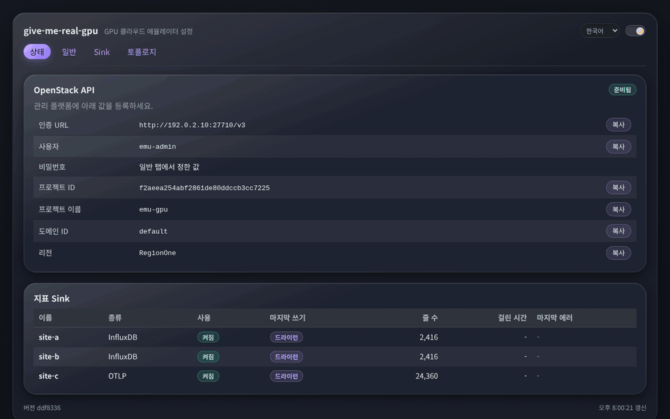

[English](README.md) | **한국어**

# give-me-real-gpu



실제 GPU 서버 없이 GPU 모니터링 화면을 채워 주는 에뮬레이터입니다.

OpenStack 을 연동하는 관리 플랫폼과 GPU 모니터링 서버를 함께 개발하거나 테스트할 때,
실제 GPU 노드와 수집 에이전트 대신 이 프로그램 하나를 띄우면 됩니다. 에뮬레이트하는 것은 두 가지입니다.

- **가짜 OpenStack API** - keystone, nova 등이 포트 하나(기본 15000)에서 경로로 나뉘어 응답합니다.
  관리 플랫폼은 이를 실제 OpenStack 으로 보고 hypervisor, VM, flavor 를 동기화합니다.
- **메트릭 쓰기** - 같은 토폴로지로 만든 GPU 메트릭과 시스템 메트릭을 두 종류의 sink 하나 이상에 주기적으로(기본
  10초마다) 씁니다.
  - `influxdb`: telegraf 수집 에이전트가 쓰는 것과 같은 모양의 InfluxDB line protocol
    (`dcgm`, `gpu_vm_mapping`, cpu, mem, disk, net 등). InfluxDB v1, v2, v3 의 쓰기 API 로 보냅니다.
  - `otlp`: OpenTelemetry 기반 수집 에이전트가 보내는 것과 같은 모양의 OTLP/HTTP 메트릭
    (hostmetrics 의 `system.*`·`process.*`, `nvidia_smi.*`, `nvml.gpm.*`, `nvidia_kmsg.xid.errors`).
    VictoriaMetrics, Prometheus, OpenTelemetry Collector 로 보낼 수 있습니다.

설정, sink, 토폴로지는 데이터 디렉터리의 sqlite 파일에 저장하고 웹 설정 화면에서 고칩니다.
저장한 변경은 재시작 없이 바로 반영됩니다.

OpenStack API 의 hypervisor hostname·서버 id 와 InfluxDB 의 `host`·`uuid` 태그가 같은 토폴로지에서 나오므로,
모니터링 서버가 둘을 조인할 수 있습니다. OTLP 데이터 포인트에는 그 대신 hypervisor 와 VM 마다 `entity_id` 가 붙습니다.
id 는 이름에서 결정적으로 만들어지므로 재시작해도 바뀌지 않습니다.

## 에뮬레이트하는 클라우드 (기본 토폴로지)

| 노드 | GPU 공유 방식 | GPU | VM |
|------|---------------|-----|-----|
| emu-vgpu-01 | VGPU | NVIDIA A10 x4, A10-4Q (GPU 당 최대 6개) | 6, 4, 3, 0 (마지막 GPU 는 미할당) |
| emu-vgpu-02 | VGPU | Tesla T4 x2, T4-4Q (GPU 당 최대 4개) | 4, 2 |
| emu-mig-01 | MIG | A100-SXM4-80GB x4 | GPU0 1g.10gb x7, GPU1 2g.20gb x3, GPU2 3g.40gb x2, GPU3 7g.80gb x1 (일부 인스턴스는 미할당) |
| emu-mig-02 | MIG | H100 80GB HBM3 x2 | 1g.10gb x7, 3g.40gb x2 |
| emu-pt-01 | PASSTHROUGH | L40S x4 | 3 (GPU 하나는 미할당) |
| emu-pt-02 | PASSTHROUGH | A100-PCIE-40GB x4 | 4 |

passthrough 에서는 GPU 하나를 VM 하나만 쓸 수 있습니다(물리적 제약). 모든 이름에 `emu-` 접두사를 붙여 실제 노드와 구분됩니다.
기본 노드는 저마다 GPU 유형 하나만 쓰지만, GPU 마다 유형을 따로 정해 한 노드에 섞을 수도 있습니다([토폴로지 직접 만들기](#토폴로지-직접-만들기) 참고).

기본 토폴로지 전체(id, IP, flavor 포함)를 보려면 다음을 실행합니다.

```sh
go run ./cmd/give-me-real-gpu -dump-topology
```

다른 구성을 에뮬레이트하려면 설정 화면에서 토폴로지를 고칩니다([토폴로지 직접 만들기](#토폴로지-직접-만들기) 참고).

## InfluxDB 지표

수집 1회(`interval` 마다)에 켜진 `influxdb` sink 마다 line protocol 한 묶음을 만듭니다. 토폴로지의 hypervisor 와 VM 하나하나가
수집 에이전트 하나 역할을 하며, 자기 행에 아래 전역 태그를 붙입니다.

| 태그 | hypervisor 에이전트 | VM 에이전트 |
|------|---------------------|-------------|
| `uuid` | `<credential_id>:<hostname>` | `<credential_id>:<server id>` |
| `credential_id` | sink 의 `credential_id` | sink 의 `credential_id` |
| `cloud_service` | `openstack` | `openstack` |
| `type` | `host` | `vm` |
| `gpu_type` | 노드에 MIG GPU 가 하나라도 있으면 `MIG`, 없고 vGPU GPU 가 있으면 `BARE_METAL`, 모든 GPU 가 passthrough 면 `NONE` | `VGPU`, `MIG`, `PASSTHROUGH` 중 하나 (VM 이 쓰는 GPU 의 유형) |
| `collection_type` | `agent` | `agent` |
| `host` | hypervisor hostname | VM 이름 |
| `time_diff` | `0` | VM 마다 고정된 `0` 또는 `-1`. 그 VM 의 타임스탬프도 같은 초만큼 밀립니다 |
| `project_id` | 없음 | 토폴로지의 project id |

hypervisor 의 `gpu_type` 은 모니터링 서버가 `nvidia-smi -q -x` 로 노드 전체를 한 번에 판정하는 방식을 따릅니다.
MIG 를 켠 GPU 가 하나라도 있으면 `MIG` 이고, 아니면 vGPU 호스트 드라이버가 `Host VGPU` 를 보고하므로 `BARE_METAL` 로 떨어집니다.
passthrough GPU 는 vfio-pci 에 묶여 보이지 않으므로, passthrough GPU 만 있는 노드는 출력이 비어 `NONE` 이 됩니다.

필드 타입은 `i`(정수), `f`(실수), `s`(문자열)입니다. "매번" 은 수집할 때마다이고, 60초·5분 행은 새 60초 또는 5분 구간의
첫 수집에서 씁니다(시작 직후 첫 수집에는 둘 다 들어갑니다).

| measurement (종류) | 쓰는 쪽 | 주기 | 전역 외 태그 | 필드 |
|--------------------|---------|------|--------------|------|
| `dcgm` 물리 GPU | hypervisor, vGPU·MIG GPU 마다 하나 (passthrough GPU 는 없음) | 매번 | `index`, `gpu`, `pstate` (`P0`/`P8`), `name`, `modelName`, `arch`, `UUID` (`GPU-...`), `compute_mode`, `pci_bus_id`, `DCGM_FI_DEV_PCI_BUSID`, `DCGM_FI_DRIVER_VERSION`, `DCGM_FI_DEV_VBIOS_VERSION`, `DCGM_FI_NVML_VERSION` | `gpu_temp`, `power_usage`, `fb_total`, `fb_used`, `fb_free`, `sm_clock`, `mem_clock`, `clocks_event_reasons`, `pcie_replay_counter`, `ecc_sbe_vol_total`, `ecc_dbe_vol_total`, `ecc_sbe_agg_total`, `ecc_dbe_agg_total` (f), `pstate` (i). MIG 가 아닐 때만: `gpu_util`, `mem_copy_util`, `enc_util`, `dec_util` (f). HBM 보드(A100, H100, H200): `memory_temp` (f). Turing, Volta, Pascal: `retired_pages_dbe`, `retired_pages_pending` (f), 그 밖의 아키텍처: `correctable_remapped_rows`, `uncorrectable_remapped_rows`, `row_remap_failure`, `row_remap_pending` (f) |
| `dcgm` GPM, 장치 | hypervisor, MIG GPU 마다 하나 | 매번 | 물리 GPU 행과 같음 | `gpu_util`, `sm_occupancy`, `graphics_util`, `dram_bw_util`, `fp32_util`, `fp16_util`, `fp64_util` (f), `server_time` (i) |
| `dcgm` GPM, MIG instance | hypervisor, MIG GPU 의 할당된 instance 마다 하나 | 매번 | 아래 vGPU/MIG VM 행과 같음 (`type=vm`) | GPM 장치 행과 같음 |
| `dcgm` vGPU/MIG VM | hypervisor, vGPU·MIG GPU 의 VM 마다 하나 (hypervisor 의 매핑 스크립트가 씀) | 60초 | 전역 태그 대신 자체 묶음: `uuid=<credential_id>:<server id>`, `type=vm`, `host=<VM 이름>`, `gpu_type` (`VGPU` 또는 `MIG`), `credential_id`, `cloud_service`, `collection_type`, `time_diff=0`, `UUID` (vGPU uuid), `gpu` (GPU 안에서 vGPU 의 순번), `modelName` (vGPU 타입 이름), `gpu_instance_id` (vGPU GPU 는 `N/A`), `physical_gpu_uuid`, `pci_bus_id`, `DCGM_FI_DEV_PCI_BUSID`, `DCGM_FI_DRIVER_VERSION`, `DCGM_FI_DEV_VBIOS_VERSION`. `project_id` 없음 | `fb_total`, `fb_used`, `fb_free`, `vgpu_license_status`, `mig_mode` (f), `pstate`, `server_time` (i). vGPU GPU 만: `gpu_util`, `mem_copy_util`, `enc_util`, `dec_util` (f) |
| `dcgm` passthrough 게스트 | passthrough VM | 매번 | 게스트에서 본 물리 GPU 태그 (`index=0`, 게스트 PCI 주소, 게스트 드라이버) 와 `DCGM_FI_CUDA_DRIVER_VERSION` | 물리 GPU 행과 같음, 사용률 필드 포함 |
| `dcgm` cuda_probe | VGPU·MIG VM | 5분 | `UUID` (`GPU-` 를 뗀 vGPU uuid), `DCGM_FI_CUDA_DRIVER_VERSION` | `cuda_probe` (i, 항상 1), `server_time` (i) |
| `dcgm` XID | passthrough VM (`uuid` 는 VM 것), 또는 VGPU/MIG VM 의 hypervisor (`uuid` 는 hypervisor 것) | GPU VM 마다 수집 1회당 확률 `xid_rate` | 전역 태그 없음. `err_code`, `DCGM_FI_DEV_PCI_BUSID` (`0000:bb:dd`), `uuid`, `UUID`, `modelName`, `DCGM_FI_DRIVER_VERSION` 만 | `xid_errors` (f, XID 코드), `err_msg` (s, 커널의 `NVRM: Xid` 줄) |
| `gpu_vm_mapping` vGPU/MIG 할당 | hypervisor, vGPU·MIG GPU 의 VM 마다 하나 | 60초 | `openstack_vm_name`, `openstack_vm_uuid`, `host_bdf`, `guest_bdf=vgpu`, `vendor_id=10de`, `device_id`, `status=assigned`, `driver=nvidia`, `gpu_type` (`vgpu` 또는 `mig`, 그 GPU 의 유형. 전역 값을 덮음), `vgpu_uuid` | `mapped` (i, 1), `vgpu_fb_mb`, `vgpu_max_instances`, `vgpu_active_instances`, `server_time` (i), `vgpu_profile`, `vgpu_model_name`, `gpu_uuid` (s) |
| `gpu_vm_mapping` passthrough 할당 | hypervisor, 할당된 passthrough GPU 마다 하나 | 60초 | 위와 같되 `vgpu_uuid` 없음. `guest_bdf` 는 게스트 PCI 주소, `driver=vfio-pci`, `gpu_type=passthrough` | `mapped` (i, 1), `server_time` (i) |
| `gpu_vm_mapping` 미할당 | 모든 hypervisor, VM 이 없는 GPU 마다 하나 | 60초 | `openstack_vm_name=N/A`, `openstack_vm_uuid=N/A`, `guest_bdf=N/A`, `host_bdf`, `vendor_id`, `device_id`, `status=unassigned`, `driver` (`nvidia` 또는 `vfio-pci`), `gpu_type` (그 GPU 유형의 소문자 이름) | `mapped` (i, 0), `vgpu_active_instances` (i, 0), `server_time` (i), `gpu_uuid` (s, passthrough GPU 는 없음) |
| `cpu` | 모든 에이전트, cpu 마다 하나와 `cpu-total` | 매번 | `cpu` (`cpu0`, `cpu1`, ..., `cpu-total`) | `usage_user`, `usage_system`, `usage_idle`, `usage_nice`, `usage_iowait`, `usage_irq`, `usage_softirq`, `usage_steal` (f), `server_time` (i) |
| `mem` | 모든 에이전트 | 매번 | - | `total`, `used`, `free`, `cached`, `buffered`, `available`, `active`, `inactive`, `shared` (i), `used_percent`, `available_percent` (f), `server_time` (i) |
| `swap` | 모든 에이전트 (VM 은 `total` 이 0) | 매번 | - | `total`, `used`, `free` (i), `used_percent` (f), `server_time` (i) |
| `disk` | 모든 에이전트, 마운트마다 하나 (hypervisor 는 `/` 와 `/boot`, VM 은 `/`) | 매번 | `device`, `fstype`, `mode`, `path`, `label` (VM 만) | `total`, `used`, `free`, `inodes_total`, `inodes_used`, `inodes_free` (i), `used_percent`, `inodes_used_percent` (f), `server_time` (i) |
| `diskio` | 모든 에이전트, 디스크 하나씩 | 매번 | `name`, `wwid` (hypervisor 만) | `reads`, `writes`, `read_bytes`, `write_bytes`, `read_time`, `write_time`, `io_time`, `iops_in_progress` (i), `io_await`, `io_svctm`, `io_util` (f), `server_time` (i) |
| `net` 인터페이스 | 모든 에이전트 (hypervisor 는 `eno1`, `eno2`, VM 은 `ens3`) | 매번 | `interface` | `bytes_recv`, `bytes_sent`, `packets_recv`, `packets_sent`, `err_in`, `err_out`, `drop_in`, `drop_out`, `server_time` (i) |
| `net` ip | `host_ip` 가 있는 hypervisor | 60초 | - | `ip` (s, 토폴로지의 `host_ip`), `server_time` (i) |
| `system` | 모든 에이전트 | 매번 | - | `load1`, `load5`, `load15` (f), `n_cpus`, `n_physical_cpus`, `uptime`, `server_time` (i). VM 만: `n_users`, `n_unique_users` (i) |
| `processes` | 모든 에이전트 | 매번 | - | `blocked`, `dead`, `idle`, `running`, `sleeping`, `stopped`, `total`, `unknown`, `zombies`, `server_time` (i) |
| `procstat` | 모든 에이전트, 프로세스 5개씩 | 60초 | `process_name`, `user`, `filter=exclude_empty_cmdline` | `cpu_usage`, `memory_usage` (f), `server_time` (i) |

기본 토폴로지(hypervisor 6대와 VM 45대, 에이전트 51개)에서 수집 1회는 2032줄이고, 60초 경계에서는 2378줄,
5분 경계에서는 2416줄이며 여기에 XID 행이 더해집니다. 그중 1600줄 가량이 `cpu` 행입니다.
값은 시드를 준 랜덤 워크입니다(sink 마다 `seed + sink id`, 개체마다 따로 난수원을 씁니다). GPU 부하가
온도·전력·클럭과 VM 의 cpu 부하를 끌고 가며, 누적 카운터(`diskio`, `net` 의 bytes·packets, `uptime`)는 늘기만 합니다.
XID 행은 GPU VM 마다 수집 1회당 확률 `xid_rate` 로 나오고, 코드는 13, 31, 43, 48, 63, 79, 94, 119 중 하나입니다.

실제 수집 파이프라인과 일부러 같게 둔 특이점이 있습니다.

- 물리 GPU 행과 passthrough 게스트의 `dcgm` 행에는 `server_time` 이 없습니다. 에이전트의 nvidia-smi 에서 dcgm 으로 바꾸는 processor 가 원래 필드를 지우기 때문입니다.
- XID 행에는 전역 태그도 `server_time`·`time_diff` 도 없습니다. 에이전트의 xid processor 가 새 metric 을 만들기 때문입니다.
- 할당된 instance 가 하나라도 있는 MIG GPU 는 통째로 할당된 것으로 보므로, 그 GPU 의 쓰지 않는 instance 에는 `unassigned` 행이 없습니다.

## OTLP 지표

수집 1회에 켜진 `otlp` sink 마다 OTLP export 요청 하나를 만듭니다. 토폴로지의 hypervisor 와 VM 하나하나가
hostmetrics receiver 와 NVIDIA GPU receiver(nvidia-smi, 커널 로그, NVML GPM)를 돌리는 OpenTelemetry 기반 수집
에이전트 하나 역할을 합니다. 모든 데이터 포인트에 노드를 가리키는 속성 하나가 붙습니다.

| 속성 | 값 |
|------|-----|
| `entity_id` | 모니터링 서버에서 노드를 가리키는 키. 기본값은 hypervisor hostname 이나 VM 이름에서 만든 UUID 라 재시작해도 같습니다. hypervisor 나 VM 에 `entity_id` 를 적으면 그 값을 씁니다([Entity ID](#entity-id) 참고) |

에이전트의 호스트 지표는 resource 속성이 없는 resource 하나입니다. process scraper 가 남기는 프로세스
(CPU 를 가장 많이 쓰는 10개와 메모리를 가장 많이 쓰는 10개)는 저마다 resource 하나이고 `process.pid`,
`process.parent_pid`, `process.executable.name`, `process.executable.path`, `process.command`,
`process.command_line`, `process.owner` 를 가지며, 그 포인트에도 `process.executable.name` 과 `process.pid` 가 붙습니다.

종류 칸의 gauge 는 gauge, sum 은 오르내리는 누적 sum, counter 는 노드 부팅(프로세스는 프로세스 시작) 시각부터
세는 단조 증가 누적 sum 입니다.
"저장 이름" 은 저장소가 Prometheus 식으로 이름을 바꾼 뒤의 예입니다(VictoriaMetrics 의
`-opentelemetry.usePrometheusNaming`). 점은 밑줄이 되고, 단위가 붙고(`s` seconds, `By` bytes, `MiBy` mebibytes,
`%` percent, `Cel` celsius, `W` watts, gauge 의 `1` 은 ratio, `{...}` 는 아무것도 안 붙음), counter 는 `_total` 로 끝납니다.

| 지표 | 종류, 단위 | `entity_id` 외 속성 | 보내는 쪽 | 저장 이름 |
|------|------------|---------------------|-----------|-----------|
| `system.cpu.time` | counter, `s` | `cpu` (`cpu0`, `cpu1`, ...), `state` (`user`, `system`, `idle`, `interrupt`, `nice`, `softirq`, `steal`, `wait`) | 모든 에이전트 | `system_cpu_time_seconds_total` |
| `system.cpu.logical.count`, `system.cpu.physical.count` | sum, `{cpu}` | - | 모든 에이전트 | `system_cpu_logical_count` |
| `system.cpu.load_average.1m`, `.5m`, `.15m` | gauge, `{thread}` | - | 모든 에이전트 | `system_cpu_load_average_1m` |
| `system.memory.usage` | sum, `By` | `state` (`buffered`, `cached`, `inactive`, `free`, `slab_reclaimable`, `slab_unreclaimable`, `used`) | 모든 에이전트 | `system_memory_usage_bytes` |
| `system.memory.utilization` | gauge, `1` | `state` | 모든 에이전트 | `system_memory_utilization_ratio` |
| `system.memory.limit`, `system.linux.memory.available`, `system.memory.linux.shared` | sum, `By` | - | 모든 에이전트 | `system_memory_limit_bytes` |
| `system.paging.usage` | sum, `By` | `device`, `state` (`used`, `free`, `cached`) | hypervisor (VM 에는 swap 이 없음) | `system_paging_usage_bytes` |
| `system.paging.operations` | counter, `{operations}` | `direction` (`page_in`, `page_out`), `type` (`major`, `minor`) | 모든 에이전트 | `system_paging_operations_total` |
| `system.paging.faults` | counter, `{faults}` | `type` | 모든 에이전트 | `system_paging_faults_total` |
| `system.disk.io` | counter, `By` | `device`, `direction` (`read`, `write`) | 모든 에이전트 | `system_disk_io_bytes_total` |
| `system.disk.operations`, `system.disk.merged` | counter, `{operations}` | `device`, `direction` | 모든 에이전트 | `system_disk_operations_total` |
| `system.disk.operation_time` | counter, `s` | `device`, `direction` | 모든 에이전트 | `system_disk_operation_time_seconds_total` |
| `system.disk.io_time`, `system.disk.weighted_io_time` | counter, `s` | `device` | 모든 에이전트 | `system_disk_io_time_seconds_total` |
| `system.disk.pending_operations` | sum, `{operations}` | `device` | 모든 에이전트 | `system_disk_pending_operations` |
| `system.filesystem.usage` | sum, `By` | `device`, `mode`, `mountpoint`, `type`, `state` (`free`, `reserved`, `used`) | 모든 에이전트 | `system_filesystem_usage_bytes` |
| `system.filesystem.inodes.usage` | sum, `{inodes}` | 위와 같음, `state` (`free`, `used`) | 모든 에이전트 | `system_filesystem_inodes_usage` |
| `system.network.io` | counter, `By` | `device`, `direction` (`receive`, `transmit`) | 모든 에이전트 | `system_network_io_bytes_total` |
| `system.network.packets`, `.errors`, `.dropped` | counter | `device`, `direction` | 모든 에이전트 | `system_network_packets_total` |
| `system.network.connections` | sum, `{connections}` | `protocol=tcp`, `state` (`ESTABLISHED`, `LISTEN`, `TIME_WAIT`, ...) | 모든 에이전트 | `system_network_connections` |
| `system.processes.count` | sum, `{processes}` | `status` (`blocked`, `idle`, `running`, `sleeping`) | 모든 에이전트 | `system_processes_count` |
| `system.processes.created` | counter, `{processes}` | - | 모든 에이전트 | `system_processes_created_total` |
| `system.uptime` | gauge, `s` | - | 모든 에이전트 | `system_uptime_seconds` |
| `process.cpu.time` | counter, `s` | `state` (`user`, `system`, `wait`) | 모든 에이전트, 남긴 프로세스마다 | `process_cpu_time_seconds_total` |
| `process.cpu.utilization` | gauge, `1` | `state` | 모든 에이전트, 남긴 프로세스마다 | `process_cpu_utilization_ratio` |
| `process.memory.usage`, `process.memory.virtual` | sum, `By` | - | 모든 에이전트, 남긴 프로세스마다 | `process_memory_usage_bytes` |
| `process.memory.utilization` | gauge, `1` (hostmetrics 가 보고하는 대로 백분율 값) | - | 모든 에이전트, 남긴 프로세스마다 | `process_memory_utilization_ratio` |
| `process.disk.io` | counter, `By` | `direction` | 모든 에이전트, 남긴 프로세스마다 | `process_disk_io_bytes_total` |
| `nvidia_smi.utilization.gpu`, `.memory`, `.encoder`, `.decoder` | gauge, `%` | `index`, `uuid`, `name` | 에이전트가 보는 모든 GPU. 단 MIG 를 켠 GPU 와 MIG 기반 vGPU 는 제외 | `nvidia_smi_utilization_gpu_percent` |
| `nvidia_smi.memory.total`, `.used`, `.free` | gauge, `MiBy` | `index`, `uuid`, `name` | 에이전트가 보는 모든 GPU | `nvidia_smi_memory_used_mebibytes` |
| `nvidia_smi.clocks.sm`, `nvidia_smi.clocks.mem` | gauge, `MHz` | `index`, `uuid`, `name` | 에이전트가 보는 모든 GPU | `nvidia_smi_clocks_sm_MHz` |
| `nvidia_smi.pstate` | gauge | `index`, `uuid`, `name` | 에이전트가 보는 모든 GPU | `nvidia_smi_pstate` |
| `nvidia_smi.temperature.gpu`, `nvidia_smi.power.draw` | gauge, `Cel` 과 `W` | `index`, `uuid`, `name` | 보드 주인: hypervisor 와 passthrough 게스트 | `nvidia_smi_temperature_gpu_celsius`, `nvidia_smi_power_draw_watts` |
| `nvidia_smi.temperature.memory` | gauge, `Cel` | `index`, `uuid`, `name` | 보드 주인, HBM 보드(A100, H100, H200) | `nvidia_smi_temperature_memory_celsius` |
| `nvidia_smi.fan.speed` | gauge, `%` | `index`, `uuid`, `name` | 보드 주인, 팬이 달린 보드(RTX, Quadro, GeForce. Server Edition 보드는 제외). 기본 토폴로지에는 없음 | `nvidia_smi_fan_speed_percent` |
| `nvidia_smi.clocks_event_reasons.active`, `nvidia_smi.ecc.errors.corrected.volatile.total` 과 나머지 `ecc.errors.*` 세 개 | gauge | `index`, `uuid`, `name` | 보드 주인 | `nvidia_smi_ecc_errors_corrected_volatile_total` |
| `nvidia_smi.retired_pages.double_bit.count`, `.pending` | gauge | `index`, `uuid`, `name` | 보드 주인, Turing·Volta·Pascal | `nvidia_smi_retired_pages_pending` |
| `nvidia_smi.remapped_rows.correctable`, `.uncorrectable`, `.pending`, `.failure` | gauge | `index`, `uuid`, `name` | 보드 주인, 그 밖의 아키텍처 | `nvidia_smi_remapped_rows_pending` |
| `nvml.gpm.sm.utilization`, `.sm.occupancy`, `.graphics.utilization`, `.dram.bandwidth.utilization`, `.fp16.utilization`, `.fp32.utilization`, `.fp64.utilization` | gauge, `%` | `index`, `uuid`, `name`. MIG 인스턴스는 `mig=true`, `gpu_instance_id`, `mig.uuid` 가 더 붙음 | Hopper 이후만: hypervisor(장치와 MIG 인스턴스마다), passthrough 게스트(장치), MIG 게스트(자기 인스턴스를 `gpu_instance_id=0` 으로) | `nvml_gpm_sm_utilization_percent` |
| `nvidia_kmsg.xid.errors` | counter, `{error}` | `uuid` (물리 GPU), `xid` | 그 XID 를 로그에 남기는 커널: vGPU·MIG VM 은 hypervisor, passthrough VM 은 게스트. 첫 XID 뒤부터 나옴 | `nvidia_kmsg_xid_errors_total` |

에이전트가 nvidia-smi 로 보는 GPU 는 이렇습니다.

- hypervisor: 모든 vGPU·MIG GPU. `GPU-...` uuid 와 모델 이름으로 보입니다. passthrough GPU 는 VM 이 있든 없든
  vfio-pci 에 묶여 있어 호스트에서 보이지 않습니다.
- GPU 가 모두 passthrough 인 hypervisor 는 아무것도 보지 못합니다. 호스트에 NVIDIA 드라이버가 없기 때문입니다(`driver_version` 이 비어 있음).
- vGPU VM: `index=0` 인 GPU 하나. uuid 는 `GPU-<vgpu_uuid>`, `name` 은 vGPU 타입, 메모리는 vGPU 프레임버퍼입니다.
  게스트는 보드를 갖지 않으므로 온도, 전력, ECC, row remapping 이 없습니다.
- MIG VM: vGPU VM 과 같되 `utilization.*` 이 없습니다.
- passthrough VM: 물리 GPU 를 보드 필드까지 모두 봅니다.
- `guest_driver_version` 이 없는 VM 은 GPU 를 보지 못합니다.

기본 토폴로지에서 수집 1회는 데이터 포인트 2만 4천 개 가량이고 그 절반이 `system.cpu.time` 입니다.
값도 시드를 준 랜덤 워크이고(sink 마다 `seed + sink id`), XID 는 같은 `xid_rate` 와 코드를 씁니다.
`-once` 는 지표 이름별 데이터 포인트 수를 출력합니다([명령줄](#명령줄) 참고).

## 빠른 시작

1. 실행합니다.

   ```sh
   docker compose up -d --build     # or: make up
   docker compose logs emulator
   ```

   처음 시작하면 `data` 볼륨에 설정 DB 를 만들고, 설정을 마칠 주소를 로그에 남깁니다.
   설정을 마치기 전까지 가짜 OpenStack API 는 모든 요청에 503 으로 답합니다.

   ```
   level=WARN msg="open the settings UI to finish setup" url=http://127.0.0.1:15080/ui/ reason="set advertise_host and the OpenStack password in the settings UI"
   ```

2. 에뮬레이터를 띄운 머신의 브라우저에서 `http://localhost:15080/` 을 엽니다. 설정 화면에는 로그인이 없어서
   compose 는 설정 포트를 `127.0.0.1` 에만 엽니다. 다른 PC 에서는 SSH 로 포트를 넘겨 받은 뒤 같은 주소를 엽니다.

   ```sh
   ssh -L 15080:localhost:15080 <host>
   ```

3. **일반** 탭에서 **공개 호스트 (advertise host)** 에 관리 플랫폼이 접근할 수 있는 이 머신의 주소(예: 문서용 주소 `192.0.2.10`)를
   넣고 **OpenStack 비밀번호** 를 정한 뒤 저장합니다. 가짜 OpenStack API 가 바로 응답하기 시작합니다.

4. **상태** 탭에 나오는 값으로 관리 플랫폼에 OpenStack credential 을 등록합니다. 같은 값이 로그의
   `fake OpenStack API ready; register this credential in the management platform` 줄에도 있습니다.

   | 항목 | 값 |
   |------|-----|
   | 인증 URL | `http://<advertise host>:<listen 포트>/v3` (예: `http://192.0.2.10:15000/v3`) |
   | 도메인 ID | `default` |
   | 사용자 | `emu-admin` |
   | 비밀번호 | 일반 탭에 저장한 OpenStack 비밀번호 |
   | 프로젝트 ID | `f2aeea254abf2861de80ddccb3cc7225` |
   | 프로젝트 이름 | `emu-gpu` |
   | 리전 | `RegionOne` |

   도메인·사용자·프로젝트·리전은 기본 토폴로지의 고정값이라(프로젝트 id 는 프로젝트 이름에서 계산합니다) 재시작해도 같습니다.
   토폴로지에서 바꿨다면 상태 탭에서 확인합니다.
   관리 플랫폼이 동기화를 마치면 위 표의 hypervisor 와 VM 이 보여야 합니다.

5. **Sink** 탭에서 sink 를 추가하고 켭니다.
   - `influxdb`: 모니터링 서버가 읽는 InfluxDB(v1, v2, v3). 4단계에서 관리 플랫폼이 돌려준 credential id 를 **Credential ID** 에
     넣습니다([InfluxDB sink](#influxdb-sink) 참고).
   - `otlp`: VictoriaMetrics, Prometheus 같은 OTLP/HTTP 엔드포인트([OTLP sink](#otlp-sink) 참고).

   저장한 sink 는 다음 주기부터 씁니다.

6. **상태** 탭을 봅니다. sink 마다 마지막 쓰기 시각, 줄 수 또는 데이터 포인트 수, 걸린 시간, 마지막 에러가 나옵니다.
   로그에는 쓸 때마다 한 줄이 남습니다.

   ```
   level=INFO msg="sink write" sink=site-a type=influxdb lines=2032 elapsed=15ms
   level=INFO msg="sink write" sink=site-b type=otlp lines=24303 elapsed=89ms
   ```

실제로 쓰기 전에 무엇이 나가는지 보려면 일반 탭의 **드라이런** 을 켭니다. 루프는 계속 돌고 줄 수만 로그로 남깁니다.
또는 `-once` 를 씁니다. 저장된 설정으로 켜진 sink 마다 메트릭을 한 번 만들어 stdout 으로 출력합니다.
서비스 이름 뒤에 준 인자는 이미지의 `-data /data` 를 대신하므로 다시 넣어 줍니다.

```sh
docker compose run --rm -T emulator -data /data -once | head
```

헬스 체크: `curl http://<host>:15000/healthz` 는 설정을 마치기 전에도 `ok` 를 돌려줍니다.

Docker 없이 돌릴 때는 데이터 디렉터리를 정해서 실행합니다. 설정 포트는 이 머신에만 엽니다.

```sh
go run ./cmd/give-me-real-gpu -data ./data -ui-listen 127.0.0.1:15080
```

## 설정 화면

설정 화면은 `-ui-listen`(기본 `:15080`)의 `/ui/` 에서 열립니다. 영어와 한국어를 지원합니다.
상단에 언어 선택 목록과 밝은/어두운 테마 스위치가 있습니다. 처음에는 언어는 브라우저 언어를, 테마는 OS 설정을 따르고,
고른 값은 브라우저에 기억합니다.

| 탭 | 하는 일 |
|-----|---------|
| 상태 | 가짜 OpenStack API 가 준비됐는지와 아니면 그 이유, 관리 플랫폼에 등록할 값, sink 마다 마지막 쓰기 시각·줄 수 또는 데이터 포인트 수·걸린 시간·마지막 에러 |
| 일반 | 아래 설정 |
| Sink | sink 추가, 수정, 켜기, 삭제 |
| 토폴로지 | 토폴로지 편집기([토폴로지 직접 만들기](#토폴로지-직접-만들기) 참고) |

저장하면 바로 반영됩니다. 가짜 OpenStack API 는 쓰는 값이 바뀔 때만 다시 만들고(그 밖의 변경에서는 발급한 토큰이
그대로 유효합니다), sink 의 쓰기 루프는 그 sink 가 쓰는 것이 바뀔 때만 다시 시작합니다: sink 자신, 토폴로지, `interval`, `seed`,
`xid_rate`, `dry_run`. 재시작이 필요한 것은 두 listen 주소뿐입니다.

### 일반 설정

| 설정 (API 키) | 기본값 | 의미 |
|---------------|--------|------|
| 공개 호스트 (`advertise_host`) | 비어 있음 | keystone catalog URL 의 호스트. 관리 플랫폼이 접근할 수 있는 주소. 비어 있는 동안 가짜 OpenStack API 는 503 으로 답합니다 |
| OpenStack 비밀번호 (`openstack_password`) | 비어 있음 | 가짜 keystone 비밀번호. 비어 있는 동안 가짜 OpenStack API 는 503 으로 답합니다. 사용자와 프로젝트 이름은 토폴로지에서 가져옵니다 |
| 토큰 유효 시간 (`token_ttl`) | `1h` | 발급한 토큰의 유효 기간 |
| 쓰기 주기 (`interval`) | `10s` | 메트릭을 만들어 쓰는 주기. 최소 1s |
| 시드 (`seed`) | `1` | 메트릭 값의 난수 시드. sink 마다 `seed + sink id` 를 씁니다 |
| XID 에러 비율 (`xid_rate`) | `0.002` | 한 주기에 GPU VM 하나가 XID 이벤트를 낼 확률 (0~1) |
| 드라이런 (`dry_run`) | 꺼짐 | 메트릭을 만들어 개수만 로그로 남기고 어느 sink 에도 쓰지 않습니다 |

기간 값은 `"10s"`, `"1h"` 같은 문자열입니다.

### 설정 API

설정 화면은 같은 포트의 `/api/v1` 아래 JSON API 를 씁니다. 이 머신에서 스크립트로도 부를 수 있습니다.

```sh
curl -s http://localhost:15080/api/v1/status
curl -s -X PUT http://localhost:15080/api/v1/settings \
  -H 'Content-Type: application/json' \
  -d '{"advertise_host": "192.0.2.10", "openstack_password": "<change-me>"}'
```

| 메서드와 경로 | 하는 일 |
|---------------|---------|
| `GET /api/v1/status` | 상태 탭에 나오는 내용 |
| `GET`, `PUT /api/v1/settings` | 일반 설정. `PUT` 에서 뺀 키는 값을 그대로 둡니다 |
| `GET`, `POST /api/v1/sinks`, `PUT`, `DELETE /api/v1/sinks/<id>` | sink. `PUT` 에서 뺀 키는 값을 그대로 둡니다 |
| `POST /api/v1/sinks`, `PUT /api/v1/sinks/<id>` 의 `tag_rules` | 그 sink 의 [tag 와 라벨 규칙](#tag-와-라벨-규칙). `PUT` 은 목록 전체를 바꾸고, `[]` 이면 규칙을 모두 지웁니다. 키를 빼거나 `null` 로 보내면 저장된 규칙을 그대로 둡니다 |
| `GET /api/v1/tag-keys` | 저장된 토폴로지가 규칙 없이 보내는 tag 키(`influxdb`)와 라벨 키(`otlp`), 키마다 예시 값 하나. [tag 와 라벨 규칙](#tag-와-라벨-규칙) 참고 |
| `GET`, `PUT /api/v1/topology`, `POST /api/v1/topology/reset` | 저장된 토폴로지. `PUT` 은 빈 칸을 채우지 않고 보낸 그대로 저장합니다 |
| `POST /api/v1/topology/fill` | 본문의 토폴로지에서 빈 칸을 채우고 문제를 나열합니다. 저장하지 않습니다 |
| `GET /api/v1/topology/catalog` | 편집기가 내놓는 GPU 모델, 프로필, flavor. 모델마다 쓸 수 있는 유형(`modes`)과 MIG slice 수(`max_mig_slices`)도 있습니다 |

저장이 거부되면 400 과 함께 문제를 모두 돌려줍니다. 예:
`{"error":"validation failed","problems":["sink \"y\": db is empty"]}`. 알 수 없는 키는 오타로 보고 거부합니다.
비밀번호와 토큰은 받기만 하고 내보내지 않습니다. 응답에는 `openstack_password_set`, `password_set`, `token_set` 만 있습니다.

로그인이 없으므로, 이 머신의 브라우저에 열린 웹 페이지가 보낼 수 있는 요청은 거부합니다.

- `Host` 헤더가 IP 주소나 `localhost` 가 아니면 403 입니다(DNS rebinding 을 막습니다). 설정 화면은 호스트 이름이 아니라
  IP 나 `localhost` 로 엽니다.
- 다른 사이트에서 온 상태 변경 요청(`Sec-Fetch-Site` 또는 `Origin`)은 403 입니다.
- 본문이 `application/json` 이 아니면 415 입니다.

curl 과 스크립트는 `Origin` 을 보내지 않으므로 통과합니다.

## Sink

sink 하나가 목적지 하나입니다. 켜진 sink 는 수집할 때마다 모두 받습니다.

| 항목 (API 키) | 의미 |
|---------------|------|
| 이름 (`name`) | 겹치면 안 됩니다. 로그와 상태 탭에 쓰입니다 |
| 종류 (`type`) | `influxdb` 또는 `otlp` |
| URL (`url`) | 호스트가 있는 `http://` 또는 `https://`. `user:password@` 를 넣으면 안 되고 사용자 이름·비밀번호 칸을 씁니다 |
| 사용자 이름, 비밀번호 (`username`, `password`) | `influxdb` v1 과 `otlp` sink 의 HTTP Basic 인증. 둘 다 비어 있으면 인증 없이 씁니다. `influxdb` v2·v3 sink 는 쓰지 않습니다 |
| API 토큰, Bearer 토큰 (`token`) | `influxdb` v2·v3 sink 의 API 토큰, 또는 `otlp` sink 의 Bearer 토큰 |
| 켜기 (`enabled`) | 켜진 sink 에만 쓰고 그때만 모든 칸을 검사하므로, 꺼진 sink 는 덜 채운 채로 두어도 됩니다 |
| tag·라벨 규칙 (`tag_rules`) | 선택입니다. tag 키(`influxdb`)나 속성 키(`otlp`)를 바꾸고, 빼고, 더하는 순서 있는 규칙 목록. 비어 있으면 그대로 씁니다. [tag 와 라벨 규칙](#tag-와-라벨-규칙) 참고 |

비밀번호와 토큰은 DB 파일(권한 0600)에 평문으로 저장하고 API 로 내보내지 않습니다.
수정할 때 칸을 비워 두면 저장된 값을 그대로 씁니다. **URL 을 바꾸면 저장된 비밀번호와 토큰을 지웁니다.**
같은 저장에서 새 값을 넣으면 그 값을 씁니다. 옛 계정을 가진 채로 sink 를 다른 서버로 돌릴 수 없게 하려는 것입니다.
종류나 InfluxDB 버전을 바꾸면 새 방식이 쓰지 않는 저장 비밀값을 지웁니다. `influxdb` sink 를 v1 에서 v2·v3 로 바꾸면
사용자 이름과 비밀번호를, v2·v3 에서 v1 로 바꾸면 토큰을 지웁니다.

### InfluxDB sink

`influxdb` sink 하나가 InfluxDB 데이터베이스(v1, v3) 또는 버킷(v2) 하나입니다. `influx_version` 으로 쓰기 API 를
고릅니다: `v1`(빼면 기본값), `v2`, `v3`. 화면에서는 종류를 **InfluxDB (line protocol)** 로 고른 뒤
**InfluxDB 버전** 을 고르고, 버전에 따라 입력 칸이 바뀝니다.

| InfluxDB 버전 (`influx_version`) | 요청 | 인증 | 켜려면 필요한 것 |
|----------------------------------|------|------|------------------|
| `v1` (기본) | `POST <url>/write?db=<db>&precision=ns` | 사용자 이름·비밀번호로 HTTP Basic, 둘 다 비면 인증 없음 | `url`, `db`, `credential_id` |
| `v2` | `POST <url>/api/v2/write?org=<org>&bucket=<db>&precision=ns` | `Authorization: Token <token>` | `url`, `org`, `db`(버킷), `token`, `credential_id` |
| `v3` | `POST <url>/api/v3/write_lp?db=<db>&precision=nanosecond` | `Authorization: Bearer <token>`, 토큰이 비면 헤더 없음 | `url`, `db`(데이터베이스), `credential_id` |

모든 버전에 쓰는 항목입니다.

| 항목 (API 키) | 어디서 가져오나 |
|---------------|-----------------|
| URL (`url`) | 모니터링 서버가 읽는 InfluxDB, 즉 실제 수집 에이전트가 쓰는 곳. `http://` 또는 `https://` 와 포트(기본은 v1·v2 가 8086, v3 가 8181) |
| Credential ID (`credential_id`) | [빠른 시작](#빠른-시작) 4단계에서 등록한 OpenStack credential 에 관리 플랫폼이 붙인 id. UUID 이고 켜려면 필요합니다. `credential_id` 태그 값과 `uuid` 태그의 접두사가 됩니다 |

#### InfluxDB v1

```sh
curl -s -X POST http://localhost:15080/api/v1/sinks \
  -H 'Content-Type: application/json' \
  -d '{"name": "site-a", "type": "influxdb", "url": "http://192.0.2.30:8086", "db": "telegraf",
       "username": "<influxdb-user>", "password": "<change-me>",
       "credential_id": "3b9f6a52-8c1d-4e7a-9f20-6d4c5e8b1a07", "enabled": true}'
```

| 항목 (API 키) | 어디서 가져오나 |
|---------------|-----------------|
| 데이터베이스 (`db`) | 그 에이전트가 쓰는 데이터베이스 (telegraf 라면 `[[outputs.influxdb]]` 의 `database`). 켜려면 필요합니다 |
| 사용자 이름, 비밀번호 | 그 데이터베이스에 쓸 수 있는 계정. 에이전트 계정(telegraf 의 `username`, `password`)을 쓰면 됩니다. 인증이 꺼져 있으면 둘 다 비웁니다 |

#### InfluxDB v2

```sh
curl -s -X POST http://localhost:15080/api/v1/sinks \
  -H 'Content-Type: application/json' \
  -d '{"name": "site-a", "type": "influxdb", "influx_version": "v2", "url": "http://192.0.2.30:8086",
       "org": "<influxdb-org>", "db": "telegraf", "token": "<change-me>",
       "credential_id": "3b9f6a52-8c1d-4e7a-9f20-6d4c5e8b1a07", "enabled": true}'
```

| 항목 (API 키) | 어디서 가져오나 |
|---------------|-----------------|
| 조직(Organization) (`org`) | 그 버킷이 속한 조직 이름 (telegraf 라면 `[[outputs.influxdb_v2]]` 의 `organization`). 켜려면 필요합니다 |
| 버킷 (`db`) | 그 에이전트가 쓰는 버킷 (telegraf 라면 `[[outputs.influxdb_v2]]` 의 `bucket`). 켜려면 필요합니다 |
| API 토큰 (`token`) | 그 버킷에 쓰기 권한이 있는 토큰 (telegraf 라면 `[[outputs.influxdb_v2]]` 의 `token`). 켜려면 필요합니다 |

InfluxDB 화면에서는 버킷이 **Load Data > Buckets** 에 있고 토큰은 **Load Data > API Tokens** 에서 만듭니다.
`influx` CLI 로는 `influx org list`, `influx bucket list --org <org>` 로 보고,
`influx auth create --org <org> --write-bucket <bucket-id>` 로 그 버킷에만 쓸 수 있는 토큰을 만듭니다.

InfluxDB 2 는 DBRP 매핑을 거쳐 v1 경로 `/write` 로도 쓰기를 받습니다. 이 sink 는 그 경로를 쓰지 않으며,
그 경로로 쓰려면 `v1` 을 고릅니다.

#### InfluxDB v3

```sh
curl -s -X POST http://localhost:15080/api/v1/sinks \
  -H 'Content-Type: application/json' \
  -d '{"name": "site-a", "type": "influxdb", "influx_version": "v3", "url": "http://192.0.2.30:8181",
       "db": "telegraf", "token": "<change-me>",
       "credential_id": "3b9f6a52-8c1d-4e7a-9f20-6d4c5e8b1a07", "enabled": true}'
```

| 항목 (API 키) | 어디서 가져오나 |
|---------------|-----------------|
| 데이터베이스 (`db`) | 모니터링 서버가 읽는 데이터베이스. `influxdb3 create database <db>` 로 만듭니다. 켜려면 필요합니다 |
| API 토큰 (`token`) | 선택입니다. 그 데이터베이스에 쓸 수 있는 토큰. `influxdb3 create token --admin` 이 만들어 출력합니다. 서버를 `--without-auth` 로 띄웠으면 비웁니다 |

InfluxDB 3 은 표 하나에 이름마다 칸을 하나만 두므로, 같은 measurement 에서 field 로 쓰이는 이름을 tag 로 받지 않습니다.
실제 수집 에이전트는 그런 행을 씁니다(`dcgm` 의 `pstate` 는 tag 이면서 field). 그래서 `v3` sink 로 보낼 때만, 그 쓰기 안에서
같은 measurement 가 field 로 쓰는 이름의 tag 를 빼고 field 는 남깁니다. `v1`·`v2` sink 에는 그대로 보냅니다.

#### 쓰는 방식

세 버전 모두 같습니다.

- `interval` 마다 켜진 sink 하나에 한 묶음씩 그 버전의 요청으로 보냅니다. gzip 으로 압축하고, 요청 하나에 최대 5000줄입니다.
- 쓰는 줄은 버전과 관계없이 같습니다: [InfluxDB 지표](#influxdb-지표)(`dcgm`, `gpu_vm_mapping`, telegraf 지표). 위에서 말한 v3 에서 빼는 tag 만 다릅니다.
- 데이터베이스나 버킷을 만들지 않습니다. 미리 있어야 하고, 계정이나 토큰에 쓰기 권한이 있어야 합니다.
- InfluxDB 는 쓰기에 성공하면 204 로 답합니다. 네트워크 에러나 5xx 는 1초 뒤 한 번 더 보냅니다. 400 과 422(필드 타입 충돌 등. InfluxDB v2 는 422 로 답합니다)는 기록하고 나머지 요청은 계속 보냅니다.
- 성공한 묶음마다 로그에 `msg="sink write" sink=site-a type=influxdb lines=...` 가, 실패하면 에러와 함께 `msg="sink write failed"` 가 남습니다. 마지막 에러는 상태 탭에도 나옵니다.

### OTLP sink

`otlp` sink 는 [OTLP 지표](#otlp-지표)를 OTLP/HTTP 엔드포인트로 보냅니다. URL 에는 엔드포인트 전체를 적습니다.

| 받는 쪽 | URL |
|---------|-----|
| VictoriaMetrics (단일 노드) | `http://192.0.2.20:8428/opentelemetry/v1/metrics` |
| `--web.enable-otlp-receiver` 로 띄운 Prometheus | `http://192.0.2.20:9090/api/v1/otlp/v1/metrics` |
| OpenTelemetry Collector 의 OTLP receiver (HTTP) | `http://192.0.2.20:4318/v1/metrics` |

```sh
curl -s -X POST http://localhost:15080/api/v1/sinks \
  -H 'Content-Type: application/json' \
  -d '{"name": "site-b", "type": "otlp", "url": "http://192.0.2.20:8428/opentelemetry/v1/metrics", "enabled": true}'
```

- 인증: **Bearer 토큰** (`token`)이 있으면 Basic 대신 그것을 보내고, 없으면 사용자 이름·비밀번호로 Basic, 다 비어 있으면 보내지 않습니다.
- 데이터베이스와 Credential ID 는 쓰지 않으며, 둘 중 하나라도 넣은 `otlp` sink 는 저장이 거부됩니다.
- `interval` 마다 켜진 sink 하나에 protobuf(`application/x-protobuf`)를 gzip 으로 압축해 `POST` 한 번으로 보냅니다.
- 네트워크 에러나 5xx 는 1초 뒤 한 번 더 보냅니다. 4xx 는 다시 보내지 않고 응답 본문과 함께 기록합니다.
- 로그와 상태 탭에서 `otlp` sink 의 `lines` 는 데이터 포인트 수입니다.

[OTLP 지표](#otlp-지표)의 저장 이름은 저장소가 Prometheus 식 이름으로 바꾼다고 보고 적은 것입니다. VictoriaMetrics 는
`-opentelemetry.usePrometheusNaming` 을 주고 띄웁니다. 다른 저장소는 이름을 다르게 만들 수 있으니 저장된 이름을 저장소에서 확인합니다.

### tag 와 라벨 규칙

sink 마다 규칙(`tag_rules`)으로 그 sink 가 쓰는 tag(`influxdb` sink)나 보내는 속성(`otlp` sink. 화면과 저장소에서는 라벨)의
키를 바꾸고, 빼고, 더할 수 있습니다. 규칙이 없는 sink 는 [InfluxDB 지표](#influxdb-지표)와 [OTLP 지표](#otlp-지표)에
적은 그대로 씁니다.

| 동작 (`action`) | 규칙의 키 | 하는 일 |
|-----------------|-----------|---------|
| `rename` | `key`, `new_key` | `key` 의 값을 `new_key` 로 옮깁니다. `new_key` 가 이미 있으면 덮어씁니다. `key` 가 없으면 아무것도 하지 않습니다 |
| `drop` | `key` | `key` 를 뺍니다 |
| `add` | `key`, `value` | `key` 를 고정 값 `value` 로 둡니다. `key` 가 이미 있으면 덮어씁니다 |

- 규칙은 적힌 순서대로 그 sink 의 모든 줄이나 데이터 포인트에 적용합니다. 뒤의 규칙은 앞 규칙이 바꾼 결과를 봅니다.
- `influxdb` sink: tag 에만 적용합니다. measurement 이름, field 이름과 값은 그대로입니다.
- `otlp` sink: `rename`·`drop` 은 데이터 포인트 속성과 resource 속성(프로세스 resource 의 `process.pid` 등)에 적용합니다.
  `add` 는 모든 데이터 포인트에만 붙이고, resource 에서는 이미 있는 키의 값만 바꿉니다. 지표 이름은 그대로입니다.
- `rename` 과 `drop` 은 값을 바꾸지 않습니다. 이미 보내는 키의 값을 바꾸는 방법은 같은 키로 `add` 를 넣어 고정 값으로
  덮어쓰는 것뿐입니다.

아래를 어기면 저장이 거부됩니다(다른 [설정 API](#설정-api) 문제와 같이 400).

- `action` 은 `rename`, `drop`, `add` 중 하나이고 `key` 는 비어 있으면 안 됩니다.
- `rename` 은 `new_key` 가 비어 있지 않고 `key` 와 달라야 합니다.
- `add` 는 `value` 가 비어 있으면 안 됩니다(InfluxDB 는 빈 tag 값을 거부합니다).
- 키와 값에 줄바꿈이 들어가면 안 됩니다.
- sink 하나에 규칙은 최대 50개입니다.

설정 화면에서는 sink 대화 상자에서 `influxdb` sink 는 **Tag 규칙**, `otlp` sink 는 **라벨 규칙** 에서 고칩니다.
두 칸으로 나뉩니다.

- **고정 tag 붙이기** (**고정 라벨 붙이기**): 한 줄에 `key = value` 하나를 적습니다. 한 줄이 `add` 규칙 하나입니다.
- **이미 보내는 tag 바꾸기** (**이미 보내는 라벨 바꾸기**): 그 sink 가 지금 보내는 키를 많이 쓰이는 것부터 칩으로 보여 줍니다.
  칩에 마우스를 올리면 예시 값과 그 키가 실리는 곳이 보이고, 누르면 그 키의 이름을 바꾸거나 뺄 줄이 생깁니다. 칩은 규칙의 결과를
  그대로 보여 줍니다. 이름을 바꾼 키는 `host → hostname`, 뺀 키는 취소선, `add` 로 값을 덮어쓴 키는 `key = value`,
  `add` 로만 생기는 키는 `+ key = value` 로 그립니다.
  줄의 키 칸도 같은 키를 목록으로 보여 줍니다. 목록에서 고르거나 아무 키나 직접 입력합니다.

화면은 바꾸기 줄을 적힌 순서대로 먼저, 고정 tag 를 그 뒤에 저장합니다. 그래서 고정으로 넣은 key=value 는 항상 결과에 남습니다.
API 로 `add` 를 목록 가운데에 넣어 저장한 sink 도 화면에서는 같은 방식으로 보이고, 화면에서 다시 저장하면 이 순서로 저장됩니다.

칩 목록은 `GET /api/v1/tag-keys` 가 줍니다. 저장된 토폴로지로 규칙 없이 수집을 한 번 돌려 버리고, sink 종류마다 모든 키와
예시 값, 그 키가 실리는 measurement(InfluxDB)나 `resource`·`point`(OTLP)를 돌려줍니다. `?credential_id=<id>` 를 붙이면
예시의 `credential_id` tag 와 `uuid` 앞부분을 그 값으로 채웁니다.

API 로는 규칙을 sink 와 함께 보냅니다.

```sh
curl -s -X POST http://localhost:15080/api/v1/sinks \
  -H 'Content-Type: application/json' \
  -d '{"name": "site-a", "type": "influxdb", "url": "http://192.0.2.30:8086", "db": "telegraf",
       "username": "<influxdb-user>", "password": "<change-me>",
       "credential_id": "3b9f6a52-8c1d-4e7a-9f20-6d4c5e8b1a07", "enabled": true,
       "tag_rules": [
         {"action": "rename", "key": "host", "new_key": "hostname"},
         {"action": "drop", "key": "time_diff"},
         {"action": "add", "key": "env", "value": "dev"}
       ]}'
```

이 규칙이면 `emu-vgpu-01` 의 `swap` 줄이 아래처럼 바뀝니다. tag 는 여전히 키 순서로 정렬해 쓰고, 값은 바꾸지 않으므로
`uuid` 값에는 hostname 이 그대로 남습니다.

```text
# 전
swap,cloud_service=openstack,collection_type=agent,credential_id=3b9f6a52-8c1d-4e7a-9f20-6d4c5e8b1a07,gpu_type=BARE_METAL,host=emu-vgpu-01,time_diff=0,type=host,uuid=3b9f6a52-8c1d-4e7a-9f20-6d4c5e8b1a07:emu-vgpu-01 free=8581344658i,server_time=1795713527i,total=8589934592i,used=8589934i,used_percent=0.1 1795713527434360688
# 후
swap,cloud_service=openstack,collection_type=agent,credential_id=3b9f6a52-8c1d-4e7a-9f20-6d4c5e8b1a07,env=dev,gpu_type=BARE_METAL,hostname=emu-vgpu-01,type=host,uuid=3b9f6a52-8c1d-4e7a-9f20-6d4c5e8b1a07:emu-vgpu-01 free=8581344658i,server_time=1795713527i,total=8589934592i,used=8589934i,used_percent=0.1 1795713527434360688
```

`otlp` sink 에서 `{"action": "rename", "key": "entity_id", "new_key": "node_id"}` 는 `emu-vgpu-01` 의 모든 데이터
포인트에서 노드 키를 옮깁니다.

```text
# 전
system.uptime  entity_id=1a011d3e-2c7f-52df-b57c-ef644f3bc056
# 후
system.uptime  node_id=1a011d3e-2c7f-52df-b57c-ef644f3bc056
```

**키를 바꾸면 이 데이터를 읽는 모니터링 서버가 못 찾을 수 있습니다.** 모니터링 서버는 InfluxDB 줄을 `credential_id`,
`uuid`, `host` 같은 tag 로, OTLP 데이터를 `entity_id` 로 찾으므로 이름을 바꾸거나 뺀 키는 그 쿼리와 맞지 않습니다.
줄을 서로 구분하는 키(`cpu` 줄의 `cpu`, `dcgm` 줄의 `index` 등)를 빼면 저장소에서 그 포인트끼리 겹칩니다.
다른 이름을 기대하는 쪽에 맞출 때만 규칙을 쓰고, 아니면 비워 둡니다.

검사하지 않는 것이 두 가지 더 있습니다. 규칙으로 같은 measurement 의 field 와 이름이 같은 tag 를 만들면 `v3` sink 에서는 그 tag 가
빠지고([InfluxDB v3](#influxdb-v3) 참고), v1·v2 는 둘 다 받으므로 InfluxQL 에서 `::tag` 로 구분해야 합니다. 저장소가 쓰는 예약 키
(`time`, v2 의 `_measurement`·`_field`·`_value`·`_start`·`_stop`)는 거부하지 않지만 쓰기나 조회가 깨집니다.

## 토폴로지 직접 만들기

토폴로지(노드, GPU, VM, flavor, 프로젝트, 사용자)는 DB 에 저장됩니다. 처음 시작할 때 기본 6노드를 저장합니다.
설정 화면의 **토폴로지** 탭에서 고치며, 저장하면 가짜 OpenStack API 와 모든 sink 에 바로 반영됩니다.

탭에는 **편집기**, **JSON**, **Entity ID** 세 가지 보기가 있습니다.

### 편집기

- 팔레트에서 노드(vGPU, MIG, Passthrough)는 캔버스에, GPU 모델은 노드에, VM 은 GPU 에 끌어다 놓습니다.
  MIG GPU 에서는 VM 을 GPU 인스턴스 칸에 놓거나, 빈 칸에 놓아 그 VM 이 쓸 인스턴스를 만듭니다.
- 끌어다 놓은 노드의 종류가 그 노드의 기본 유형, 즉 새로 넣는 GPU 가 받는 유형입니다. 목록의 GPU 모델은 어느 노드에든
  들어갑니다. 새 GPU 는 모델이 노드의 기본 유형을 지원하면 그 유형을, 아니면 모델이 지원하는 첫 유형을 받습니다(아래 표 참고).
  GPU 유형이 섞인 노드는 헤더에 유형 태그가 유형마다 하나씩 붙습니다.
- VM 을 다른 GPU 로 끌면 옮겨집니다. 노드, GPU, VM 을 팔레트의 삭제 칸에 놓으면 지워집니다.
- 노드, GPU, VM 을 우클릭하거나, 포커스가 있을 때 Shift+F10 이나 메뉴 키를 누르면 메뉴가 열립니다. 노드 메뉴에서는 아무
  모델의 GPU 를 넣거나 노드를 지우고, GPU 메뉴에서는 VM 을 넣거나 GPU 유형을 바꾸거나 GPU 를 지우고, VM 메뉴에서는 VM 을
  지웁니다. **Delete** 키는 선택한 노드, GPU, VM 을 지웁니다.
- 규칙을 어기는 자리에는 놓이지 않고 이유가 그 자리에 나옵니다: passthrough GPU 에는 VM 하나, vGPU GPU 에는 프로필의
  최대 수까지, MIG GPU 의 인스턴스는 모델의 slice 수 안에서만(A100·H100 은 7, RTX PRO 6000 Blackwell 은 4) 들어갑니다.
- 노드, GPU, VM 을 누르면 **속성** 에서 고칩니다: 이름, 크기, IP, flavor, 노드의 **기본 유형**, GPU 의 **유형**,
  vGPU 프로필, MIG 인스턴스와 인스턴스마다의 vGPU 종류, `entity_id`.
- GPU 유형을 바꾸면 VM 은 남기고 새 유형에 맞게 고칩니다. MIG 로 바꾼 GPU 는 VM 마다 가장 작은 프로필의 인스턴스를
  하나씩 만듭니다. 자리가 모자라 넘치는 VM(passthrough GPU 의 두 번째 VM, 프로필 최대 수를 넘는 VM, MIG slice 가
  남지 않아 인스턴스를 못 만든 VM)은 지우고 그 이름을 알려 줍니다.
- 비워 둔 id, uuid, 주소, bus id, 드라이버 버전, flavor 는 기본 토폴로지와 같은 결정적 규칙으로 채웁니다
  (hypervisor IP 는 `192.0.2.0/24`, VM IP 는 `198.51.100.0/24` 와 `203.0.113.0/24` 에서). 직접 넣은 값은 그대로 둡니다.
- 문제는 해당 노드, GPU, VM 옆에 나옵니다. 문제가 있으면 **저장** 이 거부됩니다.
  **되돌리기** 는 저장된 토폴로지를 다시 불러오고, **기본값으로** 는 저장된 토폴로지를 기본 6노드로 바꿔 바로 저장합니다.

편집기가 내놓는 GPU 모델과 쓸 수 있는 유형입니다.

| GPU 모델 | 유형 | vGPU 프로필 | MIG 프로필 | MIG slice |
|----------|------|-------------|------------|-----------|
| NVIDIA A10 | VGPU, PASSTHROUGH | NVIDIA A10-4Q | - | - |
| Tesla T4 | VGPU, PASSTHROUGH | GRID T4-4Q | - | - |
| NVIDIA A100-SXM4-80GB | MIG, PASSTHROUGH | - | 1g.10gb, 2g.20gb, 3g.40gb, 7g.80gb | 7 |
| NVIDIA H100 80GB HBM3 | MIG, PASSTHROUGH | - | 1g.10gb, 3g.40gb | 7 |
| NVIDIA L40S | PASSTHROUGH | - | - | - |
| NVIDIA A100-PCIE-40GB | PASSTHROUGH | - | - | - |
| NVIDIA RTX PRO 6000 Blackwell Server Edition | VGPU, MIG, PASSTHROUGH | DC-8Q ~ DC-96Q 와 DC-8C ~ DC-96C (각각 8, 12, 16, 24, 32, 48, 96 GB), 첫 항목은 DC-24Q | 1g.24gb, 2g.48gb, 4g.96gb | 4 |

새 GPU 는 그 모델의 첫 vGPU 프로필을 받습니다. MIG 프로필마다 인스턴스가 쓸 수 있는 vGPU 종류가 있고 첫 항목이 기본입니다.
A100·H100 은 인스턴스마다 하나, RTX PRO 6000 Blackwell 은 Q(그래픽)와 C(연산) 두 가지입니다
(1g.24gb 는 `DC-1-24Q`·`DC-1-24C`, 2g.48gb 는 `DC-2-48Q`·`C`, 4g.96gb 는 `DC-4-96Q`·`C`).

RTX PRO 6000 Blackwell 은 이 목록에만 있고 기본 토폴로지에는 들어 있지 않습니다. 이름, PCI device id(2bb5), 메모리,
VBIOS, 아키텍처, 2g.48gb 의 메모리와 GI ID(1, 2), vGPU 이름의 형식은 실제 장비에서 받아 둔 nvidia-smi 출력에서 가져왔습니다.
vGPU 크기와 최대 수는 이 보드에 대한 NVIDIA 의 vGPU 타입 표를 따릅니다. 1g.24gb 와 4g.96gb 의 메모리, 1g.24gb 의
GI ID(3~6)는 추정값이고, mdev 타입 번호(`nvidia-NNN`)는 다른 모델과 마찬가지로 지어낸 값입니다.

### JSON 보기

JSON 보기는 토폴로지 전체를 아래 [키](#키) 형식으로 보여 줍니다. 고치거나 붙여 넣고 **적용** 을 누르면
편집기와 같은 방식으로 빈 칸을 채우고 문제를 나열합니다. 그다음 **저장** 합니다.
기본 토폴로지를 파일로 받아 시작하려면 다음을 실행합니다.

```sh
go run ./cmd/give-me-real-gpu -dump-topology > topology.json
# Go 가 없으면 docker compose 가 빌드한 이미지로
docker run --rm give-me-real-gpu:dev -dump-topology > topology.json
```

처음에는 이름만 있어도 됩니다. 아래는 vGPU 노드 하나에 A10 한 장, VM 하나입니다.

```json
{
  "hypervisors": [
    {
      "hostname": "emu-vgpu-01",
      "mode": "VGPU",
      "gpus": [
        {"index": 0, "model_name": "NVIDIA A10", "vms": [{"name": "emu-vgpu01-g0-1", "mig_gpu_instance_id": -1}]}
      ]
    }
  ]
}
```

VM 마다 `"mig_gpu_instance_id": -1` 을 적습니다. 0 도 올바른 MIG GPU 인스턴스 id 이므로 키를 빼면 빈 값으로 보지 않습니다.
MIG GPU 에서 -1 이면 비어 있는 첫 인스턴스를 고릅니다. GPU `index` 도 0 이 올바른 값이라 채우지 않습니다.

### 가장 작은 토폴로지

위 예를 적용하면 아래처럼 됩니다. 값은 모두 기본 토폴로지와 같습니다.

```json
{
  "region": "RegionOne",
  "domain_id": "default",
  "project_id": "f2aeea254abf2861de80ddccb3cc7225",
  "project_name": "emu-gpu",
  "user_id": "bbd08f19db80d3d802e4789fc042589f",
  "user_name": "emu-admin",
  "hypervisors": [
    {
      "id": 1,
      "uuid": "822a5a71-e486-59c6-b836-7f4fae56f5a3",
      "hostname": "emu-vgpu-01",
      "host_ip": "192.0.2.11",
      "mode": "VGPU",
      "vcpus": 128,
      "memory_mb": 1048576,
      "local_gb": 3576,
      "driver_version": "595.91.04",
      "cuda_version": "13020",
      "gpus": [
        {
          "index": 0,
          "uuid": "GPU-de1a1acc-d068-5846-a4eb-6cf09db837a0",
          "bus_id": "00000000:18:00.0",
          "host_bdf": "18:00.0",
          "model_name": "NVIDIA A10",
          "device_id": "2236",
          "memory_mib": 23028,
          "vbios": "94.02.5C.00.0A",
          "arch": "Ampere",
          "profile": {"name": "NVIDIA A10-4Q", "type": "nvidia-592", "framebuffer_mb": 4096, "max_instances": 6},
          "vms": [
            {
              "id": "da322bfb-45f5-52df-8e74-486cd3903278",
              "name": "emu-vgpu01-g0-1",
              "instance_name": "instance-00000001",
              "flavor_id": "7c97c4d2-368c-51dc-ab66-b69b6c9ed3b1",
              "ip": "198.51.100.11",
              "hypervisor": "emu-vgpu-01",
              "gpu_index": 0,
              "mode": "VGPU",
              "vgpu_uuid": "6d62e585-5e92-5ddf-8911-a4400df629de",
              "mig_gpu_instance_id": -1,
              "guest_bdf": "00:05.0",
              "guest_driver_version": "595.91.07",
              "vcpus": 8,
              "memory_mb": 32768,
              "disk_gb": 100
            }
          ]
        }
      ]
    }
  ],
  "flavors": [
    {
      "id": "7c97c4d2-368c-51dc-ab66-b69b6c9ed3b1",
      "name": "emu-vgpu-a10-4q",
      "vcpus": 8,
      "ram_mb": 32768,
      "disk_gb": 100,
      "extra_specs": {"resources:VGPU": "1", "trait:CUSTOM_NVIDIA_A10_4Q": "required"}
    }
  ]
}
```

MIG GPU 는 `profile` 대신 `mig_instances` 를 두고, 그 GPU 의 VM 은 자기가 쓰는 인스턴스를 가리킵니다.

```json
"mig_instances": [
  {"gpu_instance_id": 7, "profile": "1g.10gb", "slices": 1, "memory_mib": 9728,
   "vgpu_profile": {"name": "NVIDIA A100D-1-10C", "type": "nvidia-699", "framebuffer_mb": 10240, "max_instances": 7}}
]
```

```json
"mode": "MIG", "vgpu_uuid": "104b9515-0c86-5e9e-8603-f8122f35a1f3", "mig_gpu_instance_id": 7
```

passthrough GPU 는 둘 다 없습니다. 그 VM 에는 `vgpu_uuid` 가 없고 `mig_gpu_instance_id` 는 `-1` 입니다.
GPU 가 모두 passthrough 인 노드는 호스트에 NVIDIA 드라이버가 없으므로 `driver_version` 과 `cuda_version` 을 비워 둡니다.

한 노드에 GPU 유형을 섞을 수 있습니다. GPU 에 적은 `mode` 가 노드의 `mode` 보다 앞서고, 노드의 `mode` 는 `mode` 를
비워 둔 GPU 의 유형(그리고 편집기가 새 GPU 에 주는 기본 유형)이 됩니다. 아래 노드에는 vGPU, MIG, passthrough GPU 가
하나씩 있습니다. MIG GPU 는 인스턴스를 적어 줘야 하며, 여기서는 `profile` 만 적었습니다.

```json
{
  "hypervisors": [
    {
      "hostname": "emu-mix-01",
      "mode": "VGPU",
      "gpus": [
        {"index": 0, "model_name": "NVIDIA RTX PRO 6000 Blackwell Server Edition",
         "vms": [{"name": "emu-mix01-g0-1", "mig_gpu_instance_id": -1}]},
        {"index": 1, "model_name": "NVIDIA RTX PRO 6000 Blackwell Server Edition", "mode": "MIG",
         "mig_instances": [{"gpu_instance_id": -1, "profile": "2g.48gb"}],
         "vms": [{"name": "emu-mix01-g1-1", "mig_gpu_instance_id": -1}]},
        {"index": 2, "model_name": "NVIDIA L40S", "mode": "PASSTHROUGH",
         "vms": [{"name": "emu-mix01-g2-1", "mig_gpu_instance_id": -1}]}
      ]
    }
  ]
}
```

적용하면 GPU 0 에는 프로필 `DC-24Q` 가, GPU 1 에는 `DC-2-48Q` 를 쓰는 인스턴스 1 이 생기고 그 VM 이 인스턴스 1 을 씁니다.
VM 은 저마다 자기 GPU 의 유형을 받습니다. GPU 0 의 `mode` 는 적용 뒤에도 비어 있습니다. passthrough 가 아닌 GPU 가 있으므로
노드에 호스트 드라이버가 채워집니다. 이 노드의 hypervisor 에이전트는 `gpu_type=MIG` 를 보내고, hypervisor 의 nvidia-smi 에는
GPU 0 과 1 만 보이며, `gpu_vm_mapping` 행의 `gpu_type` 은 `vgpu`, `mig`, `passthrough` 입니다([InfluxDB 지표](#influxdb-지표) 참고).

### Entity ID

Entity ID 보기는 hypervisor 와 VM 마다 [OTLP 지표](#otlp-지표)에 붙는 `entity_id` 를 기본값인지 직접 정한 값인지와 함께
보여 주고, 한 번에 모두 복사합니다. 에뮬레이터는 노드를 모니터링 서버에 등록하지 않으므로 등록할 때 이 목록을 씁니다.

`entity_id` 가 비어 있으면 hostname 이나 VM 이름에서 만든 UUID 를 쓰므로 이름을 바꾸면 값도 바뀝니다. 고정하려면
속성의 **OTel entity_id** 나 JSON 보기에서 hypervisor·VM 의 `entity_id` 에 값을 넣습니다.

### 키

| 위치 | 키 | 의미 |
|------|-----|------|
| 최상위 | `region`, `domain_id` | keystone catalog 의 region 과 keystone 도메인 |
| 최상위 | `project_id`, `project_name` | 모든 VM 이 속한 프로젝트. `project_id` 는 필수 |
| 최상위 | `user_id`, `user_name` | 가짜 keystone 사용자. `user_name` 은 필수이고, 관리 플랫폼에 등록하는 사용자입니다 |
| `hypervisors[]` | `id`, `uuid` | nova hypervisor 정수 id 와 uuid |
| `hypervisors[]` | `hostname` | nova 의 `hypervisor_hostname`, 호스트 지표의 `host` 태그 |
| `hypervisors[]` | `host_ip` | nova `host_ip`, net 지표의 주소 |
| `hypervisors[]` | `mode` | `VGPU`, `MIG`, `PASSTHROUGH` 중 하나. `mode` 를 비워 둔 GPU 의 유형이자 편집기가 새 GPU 에 주는 기본 유형 |
| `hypervisors[]` | `vcpus`, `memory_mb`, `local_gb` | nova 가 보고하는 물리 자원 |
| `hypervisors[]` | `driver_version`, `cuda_version` | 호스트 NVIDIA 드라이버와 CUDA 드라이버 버전(`13020` 형식). GPU 가 모두 passthrough 면 비움 |
| `gpus[]` | `index` | nvidia-smi 인덱스, 0 부터 |
| `gpus[]` | `uuid` | `GPU-` 뒤에 UUID |
| `gpus[]` | `bus_id`, `host_bdf` | PCI 주소의 두 형식: `00000000:18:00.0` 과 `18:00.0`(소문자) |
| `gpus[]` | `model_name`, `device_id`, `memory_mib`, `vbios`, `arch` | 모델, PCI device id(vendor 는 항상 10de), 프레임버퍼, VBIOS, 아키텍처 |
| `gpus[]` | `mode` | 선택. `VGPU`, `MIG`, `PASSTHROUGH` 중 하나. 비우면 노드의 `mode` 를 씁니다 |
| `gpus[]` | `profile` | vGPU GPU 만: 이 GPU 에 만든 vGPU 타입(`name`, mdev `type`, `framebuffer_mb`, `max_instances`) |
| `gpus[]` | `mig_instances` | MIG GPU 만: GPU 인스턴스(`gpu_instance_id`, `profile`, `slices`, `memory_mib`, `vgpu_profile`) |
| `gpus[]` | `vms` | 이 GPU 를 쓰는 VM. `[]` 이면 미할당 GPU |
| `vms[]` | `id`, `name`, `instance_name` | nova server id, server 이름(VM 지표의 `host` 태그이기도 함), libvirt 이름 |
| `vms[]` | `hypervisor`, `gpu_index`, `mode` | VM 이 도는 곳과 유형. 이 VM 이 들어 있는 노드, GPU, 그 GPU 의 유형과 같아야 합니다 |
| `vms[]` | `flavor_id` | `flavors` 안 항목의 id |
| `vms[]` | `ip` | fixed ip |
| `vms[]` | `vgpu_uuid` | vGPU 의 mdev uuid(VGPU 와 MIG). passthrough 는 비움 |
| `vms[]` | `mig_gpu_instance_id` | 쓰는 MIG 인스턴스의 `gpu_instance_id`. 다른 GPU 는 `-1` |
| `vms[]` | `guest_bdf`, `guest_driver_version` | VM 안에서 보이는 PCI 주소와 NVIDIA 드라이버 |
| `vms[]` | `vcpus`, `memory_mb`, `disk_gb` | VM 크기 |
| `flavors[]` | `id`, `name`, `vcpus`, `ram_mb`, `disk_gb`, `extra_specs` | nova flavor. GPU flavor 는 `extra_specs` 에 `resources:VGPU` 나 `pci_passthrough:alias` 가 있습니다 |
| `hypervisors[]`, `vms[]` | `entity_id` | OTLP 지표에 붙는 노드의 `entity_id`. 선택이며, 비우면 이름에서 만든 UUID |

### 저장할 때 검사하는 규칙

편집기, 적용, 저장할 때마다 아래를 검사하고 찾은 문제를 모두 나열합니다.

- `project_id` 와 `user_name` 이 있어야 합니다. 알 수 없는 키는 오타로 보고 거부합니다.
- 다음은 겹치면 안 됩니다: hypervisor `hostname`, `id`, `uuid` / GPU `uuid` / 한 노드 안의 GPU `index` 와 `bus_id` /
  VM `name`, `id`, `instance_name`, `vgpu_uuid` / flavor `id` 와 `name`.
- 노드의 `mode` 는 `VGPU`, `MIG`, `PASSTHROUGH` 중 하나, GPU 의 `mode` 는 비어 있거나 그중 하나여야 하고, VM 의 `mode` 는
  그 GPU 의 유형(GPU 의 `mode`, 비어 있으면 노드의 `mode`)과 같아야 합니다.
- VM 의 `hypervisor` 는 그 VM 이 들어 있는 노드의 `hostname`, `gpu_index` 는 그 GPU 의 `index` 여야 하고,
  `flavor_id` 는 `flavors` 에 있어야 합니다.
- VGPU GPU: 모두 `profile` 이 있고, VM 수는 `profile.max_instances` 이하이며, 모든 VM 에 `vgpu_uuid` 가 있습니다.
- MIG GPU: 인스턴스 `slices` 합이 모델의 slice 수(A100·H100 은 7, RTX PRO 6000 Blackwell 은 4, 카탈로그에 없는 모델은 7)
  이하이고, `gpu_instance_id` 는 GPU 안에서 겹치지 않으며, VM 의 `mig_gpu_instance_id` 는 그 GPU 의 인스턴스를 가리키고,
  인스턴스 하나에 VM 은 하나까지이며, 모든 VM 에 `vgpu_uuid` 가 있습니다.
- PASSTHROUGH GPU: VM 은 하나까지이고, VM 에 `vgpu_uuid` 가 없습니다.
- VGPU 와 PASSTHROUGH GPU 에서 `mig_gpu_instance_id` 는 `-1` 입니다.

형식은 검사하지 않습니다. 관리 플랫폼과 모니터링 서버가 이 값들을 저장하므로 덤프와 같은 형식을 지킵니다
(UUID, `project_id` 와 `user_id` 는 16진수 32자).

## 명령줄

| 플래그 | 의미 |
|--------|------|
| `-data <dir>` | 설정 DB `give-me-real-gpu.db` 를 두는 디렉터리. 없으면 만듭니다(디렉터리 0700, 파일 0600). 기본값 `./data`, 이미지는 `-data /data` 로 실행합니다 |
| `-listen <addr>` | 가짜 OpenStack API 와 `/healthz` 의 주소. 기본값 `:15000`. 포트는 catalog URL 에도 들어갑니다 |
| `-ui-listen <addr>` | 설정 화면(`/ui/`)과 그 API(`/api/v1`)의 주소. 기본값 `:15080`. 로그인이 없으므로 다른 호스트에 열지 않습니다 |
| `-once` | 저장된 설정으로 켜진 sink 마다 메트릭을 한 번 만들어 stdout 으로 출력하고 끝납니다. `influxdb` sink 는 line protocol, `otlp` sink 는 지표 이름별 데이터 포인트 수입니다. 아무것도 쓰지 않습니다. DB 가 있어야 합니다 |
| `-dump-topology` | 기본 토폴로지를 JSON 으로 출력하고 끝납니다 |
| `-version` | 버전을 출력합니다 |

Docker 에서는 이미지나 서비스 이름 뒤에 준 인자가 `-data /data` 를 대신하므로, `-once` 와 함께 `-data /data` 를 다시 넣습니다.

## 빌드

```sh
make build     # bin/give-me-real-gpu
make test
make vet       # go vet + gofmt check
make docker    # image give-me-real-gpu:<git describe>
make up / make down
```

Go 표준 라이브러리 밖에서는 설정 화면 서버에 echo 를, 설정 DB 에 gorm 과 순수 Go sqlite 드라이버(cgo 없음)를 씁니다.
이미지는 `golang:1.27-alpine` 에서 빌드하고 `gcr.io/distroless/static-debian12:nonroot` 에서 실행합니다.

이 문서 맨 위의 데모 GIF(`docs/demo.ko.gif`)를 다시 만들려면 `DEMO_LANG=ko tools/demo/run.sh` 를 실행합니다. 영어판의
`docs/demo.gif` 는 `DEMO_LANG` 없이 실행합니다. node, ffmpeg, Chrome 이 필요하며 자세한 것은 `tools/demo/README.md` 에 있습니다.

## 주의할 점

- **설정 화면에는 로그인이 없습니다.** `-ui-listen` 에 닿는 사람은 누구나 sink 를 바꿔 자기 서버로 돌릴 수 있습니다.
  compose 는 `127.0.0.1` 에만 열어 두니 그대로 두고, 다른 PC 에서는 SSH 포트 포워딩을 씁니다.
- **설정은 데이터 볼륨에 있습니다.** `docker compose down -v` 를 하거나 볼륨을 지우면 설정, 비밀번호를 포함한 sink,
  토폴로지가 모두 지워지고 다음 시작은 다시 첫 실행이 됩니다. 비밀번호는 DB 파일에 평문으로 있으므로 볼륨과 그 사본을 지킵니다.
- **켜진 sink 는 실제 저장소에 씁니다.** 실제 노드의 메트릭도 받는 InfluxDB 에 붙일 때는
  관리 플랫폼에 이 에뮬레이터용 credential 을 따로 등록하고 그 credential id 만 씁니다. 메트릭은
  credential id 로 구분하므로 실제 노드의 credential id 를 다시 쓰면 데이터가 섞입니다. OTLP 도 실제 노드의
  `entity_id` 를 직접 넣으면 같은 식으로 섞입니다.
- 이 프로그램은 자신이 쓴 데이터를 지우지 않습니다. 테스트가 끝나면 sink 를 끄고, 필요하면 저장소 쪽에서 지웁니다
  (InfluxDB 는 credential id 기준, OTLP 저장소는 `entity_id` 기준).
- hypervisor 나 VM 이 토폴로지에서 빠지거나 id 가 바뀌면 예전 것이 관리 플랫폼에 남아 있을 수 있습니다.
  채워 넣은 id 는 이름에서 만들므로 이름을 바꾸면 id 도 바뀝니다. 직접 넣은 id 는 그대로 씁니다.
- catalog URL 에는 `-listen` 포트가 들어갑니다. OpenStack 포트를 호스트의 다른 포트 번호로 publish 하면 관리 플랫폼이
  닿을 수 없는 URL 을 받으므로 같은 번호로 publish 합니다.
- 가짜 API 는 관리 플랫폼이 동기화에 쓰는 조회 호출만 에뮬레이트합니다. VM 생성·삭제 같은 쓰기 요청은 처리하지 않습니다.

## 라이선스

MIT. `LICENSE` 를 참고하세요.
