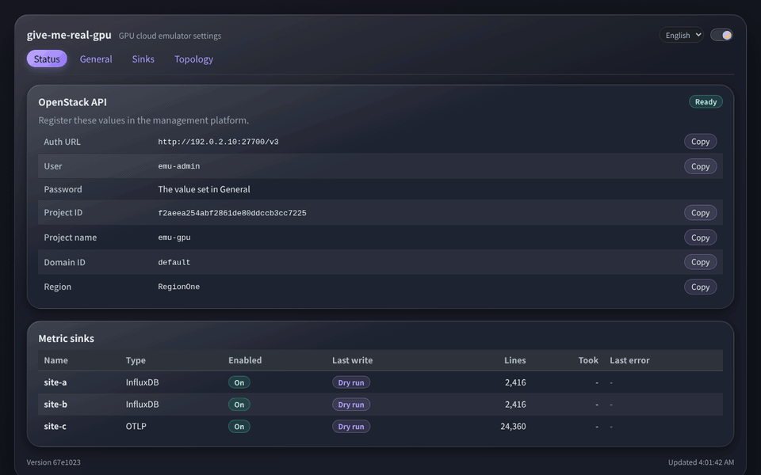

**English** | [한국어](README.ko.md)

# give-me-real-gpu



An emulator that fills GPU monitoring screens without real GPU servers.

When you develop or test a management platform that integrates with OpenStack, together with a GPU monitoring server,
run this single program instead of real GPU nodes and collection agents. It emulates two things.

- **A fake OpenStack API** - keystone, nova and friends answer on one port (default 15000), split by path.
  The management platform treats it as a real OpenStack and syncs hypervisors, VMs and flavors from it.
- **Metric writes** - GPU and system metrics built from the same topology are written periodically (default every
  10 seconds) to one or more sinks of two kinds.
  - `influxdb`: InfluxDB line protocol shaped like what a telegraf collection agent writes
    (`dcgm`, `gpu_vm_mapping`, cpu, mem, disk, net, ...), through the write API of InfluxDB v1, v2 or v3.
  - `otlp`: OTLP/HTTP metrics shaped like what an OpenTelemetry-based collection agent sends
    (hostmetrics `system.*` and `process.*`, `nvidia_smi.*`, `nvml.gpm.*`, `nvidia_kmsg.xid.errors`), for
    VictoriaMetrics, Prometheus or an OpenTelemetry Collector.

Settings, sinks and the topology are kept in a sqlite file in the data directory and edited in a web settings UI.
Saved changes take effect without a restart.

The hypervisor hostnames and server ids of the OpenStack API and the `host` and `uuid` tags in InfluxDB come from the same
topology, so the monitoring server can join the two. OTLP data points carry an `entity_id` per hypervisor and VM instead.
Ids are derived deterministically from names and stay the same across restarts.

## The emulated cloud (default topology)

| Node | GPU sharing mode | GPUs | VMs |
|------|------------------|------|-----|
| emu-vgpu-01 | VGPU | NVIDIA A10 x4, A10-4Q (up to 6 per GPU) | 6, 4, 3, 0 (last GPU unassigned) |
| emu-vgpu-02 | VGPU | Tesla T4 x2, T4-4Q (up to 4 per GPU) | 4, 2 |
| emu-mig-01 | MIG | A100-SXM4-80GB x4 | GPU0 1g.10gb x7, GPU1 2g.20gb x3, GPU2 3g.40gb x2, GPU3 7g.80gb x1 (some instances unassigned) |
| emu-mig-02 | MIG | H100 80GB HBM3 x2 | 1g.10gb x7, 3g.40gb x2 |
| emu-pt-01 | PASSTHROUGH | L40S x4 | 3 (one GPU unassigned) |
| emu-pt-02 | PASSTHROUGH | A100-PCIE-40GB x4 | 4 |

With passthrough only one VM can use a GPU (a physical constraint). Every name has the `emu-` prefix so it stands apart from real nodes.

To see the full default topology (ids, IPs and flavors included):

```sh
go run ./cmd/give-me-real-gpu -dump-topology
```

To emulate a different layout, edit the topology in the settings UI (see [Custom topology](#custom-topology)).

## InfluxDB metrics

Every collection (every `interval`) produces one batch of line protocol per enabled `influxdb` sink. Each hypervisor and each VM
in the topology acts as one collection agent and puts these global tags on its rows.

| Tag | Hypervisor agent | VM agent |
|-----|------------------|----------|
| `uuid` | `<credential_id>:<hostname>` | `<credential_id>:<server id>` |
| `credential_id` | `credential_id` of the sink | `credential_id` of the sink |
| `cloud_service` | `openstack` | `openstack` |
| `type` | `host` | `vm` |
| `gpu_type` | `BARE_METAL` on VGPU nodes, `MIG` on MIG nodes, `NONE` on passthrough nodes | `VGPU`, `MIG` or `PASSTHROUGH` (mode of its hypervisor) |
| `collection_type` | `agent` | `agent` |
| `host` | hypervisor hostname | VM name |
| `time_diff` | `0` | `0` or `-1`, fixed per VM. The timestamps of that VM are shifted by the same number of seconds |
| `project_id` | not set | project id of the topology |

The hypervisor `gpu_type` follows how the monitoring server detects it from `nvidia-smi -q -x`: a vGPU host driver reports
`Host VGPU`, which falls back to `BARE_METAL`, and a passthrough host has no nvidia driver, which gives `NONE`.

Field types are `i` (integer), `f` (float) and `s` (string). "every" is every collection; 60s and 5m rows are written on
the first collection of each new 60 second or 5 minute slot (the first collection after start includes both).

| Measurement (kind) | Written by | Interval | Tags besides the global ones | Fields |
|--------------------|------------|----------|------------------------------|--------|
| `dcgm` physical GPU | VGPU and MIG hypervisors, one per GPU (passthrough hypervisors write none) | every | `index`, `gpu`, `pstate` (`P0`/`P8`), `name`, `modelName`, `arch`, `UUID` (`GPU-...`), `compute_mode`, `pci_bus_id`, `DCGM_FI_DEV_PCI_BUSID`, `DCGM_FI_DRIVER_VERSION`, `DCGM_FI_DEV_VBIOS_VERSION`, `DCGM_FI_NVML_VERSION` | `gpu_temp`, `power_usage`, `fb_total`, `fb_used`, `fb_free`, `sm_clock`, `mem_clock`, `clocks_event_reasons`, `pcie_replay_counter`, `ecc_sbe_vol_total`, `ecc_dbe_vol_total`, `ecc_sbe_agg_total`, `ecc_dbe_agg_total` (f), `pstate` (i). Not on MIG: `gpu_util`, `mem_copy_util`, `enc_util`, `dec_util` (f). HBM boards (A100, H100, H200): `memory_temp` (f). Turing, Volta, Pascal: `retired_pages_dbe`, `retired_pages_pending` (f); other architectures: `correctable_remapped_rows`, `uncorrectable_remapped_rows`, `row_remap_failure`, `row_remap_pending` (f) |
| `dcgm` GPM, device | MIG hypervisors, one per GPU | every | same as the physical GPU row | `gpu_util`, `sm_occupancy`, `graphics_util`, `dram_bw_util`, `fp32_util`, `fp16_util`, `fp64_util` (f), `server_time` (i) |
| `dcgm` GPM, MIG instance | MIG hypervisors, one per assigned instance | every | same as the vGPU/MIG VM row below (`type=vm`) | same as the GPM device row |
| `dcgm` vGPU/MIG VM | VGPU and MIG hypervisors, one per VM (written by the mapping script on the hypervisor) | 60s | its own set instead of the global tags: `uuid=<credential_id>:<server id>`, `type=vm`, `host=<VM name>`, `gpu_type` (`VGPU` or `MIG`), `credential_id`, `cloud_service`, `collection_type`, `time_diff=0`, `UUID` (vGPU uuid), `gpu` (position of the vGPU on its GPU), `modelName` (vGPU type name), `gpu_instance_id` (`N/A` on VGPU), `physical_gpu_uuid`, `pci_bus_id`, `DCGM_FI_DEV_PCI_BUSID`, `DCGM_FI_DRIVER_VERSION`, `DCGM_FI_DEV_VBIOS_VERSION`. No `project_id` | `fb_total`, `fb_used`, `fb_free`, `vgpu_license_status`, `mig_mode` (f), `pstate`, `server_time` (i). VGPU only: `gpu_util`, `mem_copy_util`, `enc_util`, `dec_util` (f) |
| `dcgm` passthrough guest | passthrough VMs | every | the physical GPU tags as the guest sees them (`index=0`, guest PCI address, guest driver) plus `DCGM_FI_CUDA_DRIVER_VERSION` | same as the physical GPU row, with the utilization fields |
| `dcgm` cuda_probe | VGPU and MIG VMs | 5m | `UUID` (vGPU uuid without `GPU-`), `DCGM_FI_CUDA_DRIVER_VERSION` | `cuda_probe` (i, always 1), `server_time` (i) |
| `dcgm` XID | a passthrough VM (`uuid` of the VM), or the hypervisor of a VGPU/MIG VM (`uuid` of the hypervisor) | probability `xid_rate` per GPU VM per collection | no global tags, only `err_code`, `DCGM_FI_DEV_PCI_BUSID` (`0000:bb:dd`), `uuid`, `UUID`, `modelName`, `DCGM_FI_DRIVER_VERSION` | `xid_errors` (f, the XID code), `err_msg` (s, the kernel `NVRM: Xid` line) |
| `gpu_vm_mapping` vGPU/MIG assigned | VGPU and MIG hypervisors, one per VM | 60s | `openstack_vm_name`, `openstack_vm_uuid`, `host_bdf`, `guest_bdf=vgpu`, `vendor_id=10de`, `device_id`, `status=assigned`, `driver=nvidia`, `gpu_type` (`vgpu` or `mig`, replaces the global value), `vgpu_uuid` | `mapped` (i, 1), `vgpu_fb_mb`, `vgpu_max_instances`, `vgpu_active_instances`, `server_time` (i), `vgpu_profile`, `vgpu_model_name`, `gpu_uuid` (s) |
| `gpu_vm_mapping` passthrough assigned | passthrough hypervisors, one per assigned GPU | 60s | as above without `vgpu_uuid`; `guest_bdf` is the guest PCI address, `driver=vfio-pci`, `gpu_type=passthrough` | `mapped` (i, 1), `server_time` (i) |
| `gpu_vm_mapping` unassigned | any hypervisor, one per GPU with no VM | 60s | `openstack_vm_name=N/A`, `openstack_vm_uuid=N/A`, `guest_bdf=N/A`, `host_bdf`, `vendor_id`, `device_id`, `status=unassigned`, `driver` (`nvidia` or `vfio-pci`), `gpu_type` (lower case mode) | `mapped` (i, 0), `vgpu_active_instances` (i, 0), `server_time` (i), `gpu_uuid` (s, not on passthrough) |
| `cpu` | all agents, one per cpu plus `cpu-total` | every | `cpu` (`cpu0`, `cpu1`, ..., `cpu-total`) | `usage_user`, `usage_system`, `usage_idle`, `usage_nice`, `usage_iowait`, `usage_irq`, `usage_softirq`, `usage_steal` (f), `server_time` (i) |
| `mem` | all agents | every | - | `total`, `used`, `free`, `cached`, `buffered`, `available`, `active`, `inactive`, `shared` (i), `used_percent`, `available_percent` (f), `server_time` (i) |
| `swap` | all agents (`total` is 0 on VMs) | every | - | `total`, `used`, `free` (i), `used_percent` (f), `server_time` (i) |
| `disk` | all agents, one per mount (hypervisor `/` and `/boot`, VM `/`) | every | `device`, `fstype`, `mode`, `path`, `label` (VM only) | `total`, `used`, `free`, `inodes_total`, `inodes_used`, `inodes_free` (i), `used_percent`, `inodes_used_percent` (f), `server_time` (i) |
| `diskio` | all agents, one disk each | every | `name`, `wwid` (hypervisor only) | `reads`, `writes`, `read_bytes`, `write_bytes`, `read_time`, `write_time`, `io_time`, `iops_in_progress` (i), `io_await`, `io_svctm`, `io_util` (f), `server_time` (i) |
| `net` interface | all agents (hypervisor `eno1`, `eno2`; VM `ens3`) | every | `interface` | `bytes_recv`, `bytes_sent`, `packets_recv`, `packets_sent`, `err_in`, `err_out`, `drop_in`, `drop_out`, `server_time` (i) |
| `net` ip | hypervisors with a `host_ip` | 60s | - | `ip` (s, `host_ip` of the topology), `server_time` (i) |
| `system` | all agents | every | - | `load1`, `load5`, `load15` (f), `n_cpus`, `n_physical_cpus`, `uptime`, `server_time` (i). VM only: `n_users`, `n_unique_users` (i) |
| `processes` | all agents | every | - | `blocked`, `dead`, `idle`, `running`, `sleeping`, `stopped`, `total`, `unknown`, `zombies`, `server_time` (i) |
| `procstat` | all agents, 5 processes each | 60s | `process_name`, `user`, `filter=exclude_empty_cmdline` | `cpu_usage`, `memory_usage` (f), `server_time` (i) |

With the default topology (6 hypervisors and 45 VMs, so 51 agents) one collection is 2032 lines, 2378 on a 60 second
boundary and 2416 on a 5 minute boundary, plus any XID rows. About 1600 of them are `cpu` rows.
Values are seeded random walks (each sink uses `seed + its sink id`, each entity has its own random source), GPU load
drives temperature, power, clocks and the VM cpu load, and cumulative counters (`diskio`, `net` bytes and packets, `uptime`)
only increase. An XID row appears with probability `xid_rate` per GPU VM per collection, with one of the codes 13, 31, 43, 48, 63, 79, 94 or 119.

Some quirks match the real collection pipeline on purpose.

- Physical GPU rows and passthrough guest `dcgm` rows have no `server_time`, because the agent's nvidia-smi to dcgm processor drops the original fields.
- XID rows have none of the global tags and no `server_time` or `time_diff`, because the agent's xid processor builds a new metric.
- A MIG GPU with at least one assigned instance counts as assigned as a whole, so its unused instances get no `unassigned` row.

## OTLP metrics

Every collection produces one OTLP export request per enabled `otlp` sink. Each hypervisor and each VM in the topology
acts as one OpenTelemetry-based collection agent running the hostmetrics receiver and an NVIDIA GPU receiver
(nvidia-smi, the kernel log and NVML GPM). Every data point carries one attribute that identifies the node:

| Attribute | Value |
|-----------|-------|
| `entity_id` | The node's key in the monitoring server. By default a UUID derived from the hypervisor hostname or VM name, so it stays the same across restarts. Set `entity_id` on the hypervisor or VM to use another value (see [Entity IDs](#entity-ids)) |

The host metrics of an agent are one resource without resource attributes. Each process the process scraper keeps
(the 10 using the most CPU and the 10 using the most memory) is a resource of its own with `process.pid`,
`process.parent_pid`, `process.executable.name`, `process.executable.path`, `process.command`,
`process.command_line` and `process.owner`, and its points also carry `process.executable.name` and `process.pid`.

In the Type column, gauge is a gauge, sum is a cumulative sum that goes up and down, and counter is a cumulative
monotonic sum that starts at the boot of the node (or the start of the process).
"Stored as" is an example of the name after the Prometheus-style conversion a backend applies (VictoriaMetrics with
`-opentelemetry.usePrometheusNaming`): dots become underscores, the unit is appended (`s` seconds, `By` bytes,
`MiBy` mebibytes, `%` percent, `Cel` celsius, `W` watts, `1` ratio on gauges, `{...}` nothing) and counters end in `_total`.

| Metric | Type, unit | Attributes besides `entity_id` | Sent by | Stored as |
|--------|------------|--------------------------------|---------|-----------|
| `system.cpu.time` | counter, `s` | `cpu` (`cpu0`, `cpu1`, ...), `state` (`user`, `system`, `idle`, `interrupt`, `nice`, `softirq`, `steal`, `wait`) | all agents | `system_cpu_time_seconds_total` |
| `system.cpu.logical.count`, `system.cpu.physical.count` | sum, `{cpu}` | - | all agents | `system_cpu_logical_count` |
| `system.cpu.load_average.1m`, `.5m`, `.15m` | gauge, `{thread}` | - | all agents | `system_cpu_load_average_1m` |
| `system.memory.usage` | sum, `By` | `state` (`buffered`, `cached`, `inactive`, `free`, `slab_reclaimable`, `slab_unreclaimable`, `used`) | all agents | `system_memory_usage_bytes` |
| `system.memory.utilization` | gauge, `1` | `state` | all agents | `system_memory_utilization_ratio` |
| `system.memory.limit`, `system.linux.memory.available`, `system.memory.linux.shared` | sum, `By` | - | all agents | `system_memory_limit_bytes` |
| `system.paging.usage` | sum, `By` | `device`, `state` (`used`, `free`, `cached`) | hypervisors (VMs have no swap) | `system_paging_usage_bytes` |
| `system.paging.operations` | counter, `{operations}` | `direction` (`page_in`, `page_out`), `type` (`major`, `minor`) | all agents | `system_paging_operations_total` |
| `system.paging.faults` | counter, `{faults}` | `type` | all agents | `system_paging_faults_total` |
| `system.disk.io` | counter, `By` | `device`, `direction` (`read`, `write`) | all agents | `system_disk_io_bytes_total` |
| `system.disk.operations`, `system.disk.merged` | counter, `{operations}` | `device`, `direction` | all agents | `system_disk_operations_total` |
| `system.disk.operation_time` | counter, `s` | `device`, `direction` | all agents | `system_disk_operation_time_seconds_total` |
| `system.disk.io_time`, `system.disk.weighted_io_time` | counter, `s` | `device` | all agents | `system_disk_io_time_seconds_total` |
| `system.disk.pending_operations` | sum, `{operations}` | `device` | all agents | `system_disk_pending_operations` |
| `system.filesystem.usage` | sum, `By` | `device`, `mode`, `mountpoint`, `type`, `state` (`free`, `reserved`, `used`) | all agents | `system_filesystem_usage_bytes` |
| `system.filesystem.inodes.usage` | sum, `{inodes}` | as above, `state` (`free`, `used`) | all agents | `system_filesystem_inodes_usage` |
| `system.network.io` | counter, `By` | `device`, `direction` (`receive`, `transmit`) | all agents | `system_network_io_bytes_total` |
| `system.network.packets`, `.errors`, `.dropped` | counter | `device`, `direction` | all agents | `system_network_packets_total` |
| `system.network.connections` | sum, `{connections}` | `protocol=tcp`, `state` (`ESTABLISHED`, `LISTEN`, `TIME_WAIT`, ...) | all agents | `system_network_connections` |
| `system.processes.count` | sum, `{processes}` | `status` (`blocked`, `idle`, `running`, `sleeping`) | all agents | `system_processes_count` |
| `system.processes.created` | counter, `{processes}` | - | all agents | `system_processes_created_total` |
| `system.uptime` | gauge, `s` | - | all agents | `system_uptime_seconds` |
| `process.cpu.time` | counter, `s` | `state` (`user`, `system`, `wait`) | all agents, per kept process | `process_cpu_time_seconds_total` |
| `process.cpu.utilization` | gauge, `1` | `state` | all agents, per kept process | `process_cpu_utilization_ratio` |
| `process.memory.usage`, `process.memory.virtual` | sum, `By` | - | all agents, per kept process | `process_memory_usage_bytes` |
| `process.memory.utilization` | gauge, `1` (a percentage, as hostmetrics reports it) | - | all agents, per kept process | `process_memory_utilization_ratio` |
| `process.disk.io` | counter, `By` | `direction` | all agents, per kept process | `process_disk_io_bytes_total` |
| `nvidia_smi.utilization.gpu`, `.memory`, `.encoder`, `.decoder` | gauge, `%` | `index`, `uuid`, `name` | every GPU an agent sees, except MIG enabled GPUs and MIG-backed vGPUs | `nvidia_smi_utilization_gpu_percent` |
| `nvidia_smi.memory.total`, `.used`, `.free` | gauge, `MiBy` | `index`, `uuid`, `name` | every GPU an agent sees | `nvidia_smi_memory_used_mebibytes` |
| `nvidia_smi.clocks.sm`, `nvidia_smi.clocks.mem` | gauge, `MHz` | `index`, `uuid`, `name` | every GPU an agent sees | `nvidia_smi_clocks_sm_MHz` |
| `nvidia_smi.pstate` | gauge | `index`, `uuid`, `name` | every GPU an agent sees | `nvidia_smi_pstate` |
| `nvidia_smi.temperature.gpu`, `nvidia_smi.power.draw` | gauge, `Cel` and `W` | `index`, `uuid`, `name` | the board owner: hypervisors and passthrough guests | `nvidia_smi_temperature_gpu_celsius`, `nvidia_smi_power_draw_watts` |
| `nvidia_smi.temperature.memory` | gauge, `Cel` | `index`, `uuid`, `name` | the board owner, HBM boards (A100, H100, H200) | `nvidia_smi_temperature_memory_celsius` |
| `nvidia_smi.fan.speed` | gauge, `%` | `index`, `uuid`, `name` | the board owner, actively cooled boards (RTX, Quadro, GeForce). None in the default topology | `nvidia_smi_fan_speed_percent` |
| `nvidia_smi.clocks_event_reasons.active`, `nvidia_smi.ecc.errors.corrected.volatile.total` and the other three `ecc.errors.*` | gauge | `index`, `uuid`, `name` | the board owner | `nvidia_smi_ecc_errors_corrected_volatile_total` |
| `nvidia_smi.retired_pages.double_bit.count`, `.pending` | gauge | `index`, `uuid`, `name` | the board owner, Turing, Volta and Pascal | `nvidia_smi_retired_pages_pending` |
| `nvidia_smi.remapped_rows.correctable`, `.uncorrectable`, `.pending`, `.failure` | gauge | `index`, `uuid`, `name` | the board owner, other architectures | `nvidia_smi_remapped_rows_pending` |
| `nvml.gpm.sm.utilization`, `.sm.occupancy`, `.graphics.utilization`, `.dram.bandwidth.utilization`, `.fp16.utilization`, `.fp32.utilization`, `.fp64.utilization` | gauge, `%` | `index`, `uuid`, `name`. MIG instances add `mig=true`, `gpu_instance_id`, `mig.uuid` | Hopper and later only: the hypervisor (the device and each MIG instance), a passthrough guest (the device), a MIG guest (its own instance as `gpu_instance_id=0`) | `nvml_gpm_sm_utilization_percent` |
| `nvidia_kmsg.xid.errors` | counter, `{error}` | `uuid` (physical GPU), `xid` | the kernel that logs it: the hypervisor for vGPU and MIG VMs, the guest for passthrough VMs. Appears after the first XID | `nvidia_kmsg_xid_errors_total` |

Which GPUs an agent sees with nvidia-smi:

- VGPU and MIG hypervisors: every physical GPU, with its `GPU-...` uuid and model name.
- Passthrough hypervisors: none, because the host has no NVIDIA driver (`driver_version` is empty). With a driver
  version set, the host sees the GPUs no VM uses.
- vGPU VM: one GPU at `index=0` with uuid `GPU-<vgpu_uuid>`, the vGPU type as `name` and the vGPU framebuffer as memory.
  No temperature, power, ECC or row remapping, since the guest does not own the board.
- MIG VM: like a vGPU VM, without `utilization.*`.
- Passthrough VM: the physical GPU, with every board field.
- A VM without `guest_driver_version` sees no GPU.

With the default topology one collection is about 24,000 data points, half of them `system.cpu.time`.
Values are seeded random walks as well (each sink uses `seed + its sink id`), and XIDs use the same `xid_rate` and codes.
`-once` prints the number of data points per metric name (see [Command line](#command-line)).

## Quick start

1. Start it.

   ```sh
   docker compose up -d --build     # or: make up
   docker compose logs emulator
   ```

   The first start creates the settings database in the `data` volume and logs where to finish the setup.
   Until then the fake OpenStack API answers every request with 503.

   ```
   level=WARN msg="open the settings UI to finish setup" url=http://127.0.0.1:15080/ui/ reason="set advertise_host and the OpenStack password in the settings UI"
   ```

2. Open `http://localhost:15080/` in a browser on the machine that runs the emulator. compose publishes the settings
   port on `127.0.0.1` only, because the settings UI has no login. From another PC, forward the port over SSH and open
   the same address there.

   ```sh
   ssh -L 15080:localhost:15080 <host>
   ```

3. In **General**, set **Advertise host** to an address of this machine that the management platform can reach
   (for example `192.0.2.10`, a documentation address) and set the **OpenStack password**. Save. The fake OpenStack API
   starts answering right away.

4. Register an OpenStack credential in the management platform with the values shown in **Status**. They are also in
   the log line `fake OpenStack API ready; register this credential in the management platform`.

   | Field | Value |
   |-------|-------|
   | Auth URL | `http://<advertise host>:<listen port>/v3` (for example `http://192.0.2.10:15000/v3`) |
   | Domain ID | `default` |
   | User | `emu-admin` |
   | Password | The OpenStack password saved in General |
   | Project ID | `f2aeea254abf2861de80ddccb3cc7225` |
   | Project name | `emu-gpu` |
   | Region | `RegionOne` |

   Domain, user, project and region are fixed values of the default topology (the project id is derived from the project name),
   so they stay the same across restarts. After you change them in the topology, read them from Status.
   Once the management platform syncs, the hypervisors and VMs in the table above should appear.

5. In **Sinks**, add a sink and enable it.
   - `influxdb` for the InfluxDB (v1, v2 or v3) the monitoring server reads. Put the credential id the management platform returned
     in step 4 into **Credential ID** (see [InfluxDB sinks](#influxdb-sinks)).
   - `otlp` for an OTLP/HTTP endpoint such as VictoriaMetrics or Prometheus (see [OTLP sinks](#otlp-sinks)).

   A saved sink starts writing on the next interval.

6. Check **Status**: every sink shows the last write, the line or data point count, how long it took and the last error.
   The log has a line per write.

   ```
   level=INFO msg="sink write" sink=site-a type=influxdb lines=2032 elapsed=15ms
   level=INFO msg="sink write" sink=site-b type=otlp lines=24303 elapsed=89ms
   ```

To see what would be sent before writing anything, turn on **Dry run** in General: the loop keeps running and only logs
line counts. Or use `-once`, which generates metrics once per enabled sink from the saved settings and prints them to
stdout. Arguments after the service name replace the image's `-data /data`, so pass it again.

```sh
docker compose run --rm -T emulator -data /data -once | head
```

Health check: `curl http://<host>:15000/healthz` returns `ok`, also before the setup is finished.

Without Docker, run it with a data directory of your choice. Keep the settings port on this machine.

```sh
go run ./cmd/give-me-real-gpu -data ./data -ui-listen 127.0.0.1:15080
```

## Settings UI

The settings UI is served on `-ui-listen` (default `:15080`) under `/ui/`. It is in English and Korean.
The top bar has a language select and a light/dark theme switch. On the first visit the language follows the browser
and the theme follows the OS setting; what you pick is remembered in the browser.

| Tab | What it does |
|-----|--------------|
| Status | Whether the fake OpenStack API is ready and why not, the values to register in the management platform, and per sink the last write, line or data point count, duration and last error |
| General | The settings below |
| Sinks | Add, edit, enable and delete sinks |
| Topology | The topology editor (see [Custom topology](#custom-topology)) |

Every save takes effect at once. The fake OpenStack API is rebuilt only when something it uses changes (issued tokens stay
valid otherwise), and a sink's write loop restarts only when something it uses changes: the sink itself, the topology, `interval`, `seed`,
`xid_rate` or `dry_run`. Only the two listen addresses need a restart.

### General settings

| Setting (API key) | Default | Meaning |
|-------------------|---------|---------|
| Advertise host (`advertise_host`) | empty | Host of the keystone catalog URLs. An address the management platform can reach. The fake OpenStack API answers 503 while it is empty |
| OpenStack password (`openstack_password`) | empty | Fake keystone password. The fake OpenStack API answers 503 while it is empty. User and project names come from the topology |
| Token lifetime (`token_ttl`) | `1h` | Lifetime of issued tokens |
| Write interval (`interval`) | `10s` | How often metrics are generated and written. At least 1s |
| Seed (`seed`) | `1` | Random seed for metric values. Each sink uses `seed + its sink id` |
| XID error rate (`xid_rate`) | `0.002` | Probability that a GPU VM emits an XID event in one interval (0 to 1) |
| Dry run (`dry_run`) | off | Generate metrics and log their counts without writing to any sink |

Durations are strings such as `"10s"` or `"1h"`.

### Settings API

The UI uses a JSON API under `/api/v1` on the same port, and you can script it from this machine.

```sh
curl -s http://localhost:15080/api/v1/status
curl -s -X PUT http://localhost:15080/api/v1/settings \
  -H 'Content-Type: application/json' \
  -d '{"advertise_host": "192.0.2.10", "openstack_password": "<change-me>"}'
```

| Method and path | What it does |
|-----------------|--------------|
| `GET /api/v1/status` | What the Status tab shows |
| `GET`, `PUT /api/v1/settings` | General settings. Keys left out of a `PUT` keep their value |
| `GET`, `POST /api/v1/sinks`, `PUT`, `DELETE /api/v1/sinks/<id>` | Sinks. Keys left out of a `PUT` keep their value |
| `tag_rules` in `POST /api/v1/sinks` and `PUT /api/v1/sinks/<id>` | The [tag and label rules](#tag-and-label-rules) of the sink. A `PUT` replaces the whole list; `[]` removes every rule, and leaving the key out (or `null`) keeps the saved rules |
| `GET`, `PUT /api/v1/topology`, `POST /api/v1/topology/reset` | The saved topology. `PUT` saves it as sent, without filling empty fields |
| `POST /api/v1/topology/fill` | Fills the empty fields of the topology in the body and lists its problems. Saves nothing |
| `GET /api/v1/topology/catalog` | GPU models, profiles and flavors the editor offers |

A rejected save answers 400 with every problem, for example
`{"error":"validation failed","problems":["sink \"y\": db is empty"]}`. Unknown keys are rejected as typos.
Passwords and tokens go in but never come out: responses only carry `openstack_password_set`, `password_set` and `token_set`.

There is no login, so the API refuses what a web page open in a browser on this machine could send:

- A `Host` header that is not an IP address or `localhost` gets 403 (this stops DNS rebinding). Open the UI by IP or
  `localhost`, not by host name.
- A state-changing request from another site (`Sec-Fetch-Site` or `Origin`) gets 403.
- A request body that is not `application/json` gets 415.

curl and scripts send no `Origin` and pass.

## Sinks

A sink is one destination. Every enabled sink receives every collection.

| Field (API key) | Meaning |
|-----------------|---------|
| Name (`name`) | Unique. Used in logs and in Status |
| Type (`type`) | `influxdb` or `otlp` |
| URL (`url`) | `http://` or `https://` with a host. It must not contain `user:password@`; use Username and Password |
| Username, Password (`username`, `password`) | HTTP Basic authentication for `influxdb` v1 and `otlp` sinks. When both are empty, writes are sent without authentication. `influxdb` v2 and v3 sinks ignore them |
| API token, Bearer token (`token`) | API token of an `influxdb` v2 or v3 sink, or Bearer token of an `otlp` sink |
| Enabled (`enabled`) | Only enabled sinks are written to and fully checked, so a disabled sink can be left half filled in |
| Tag rules (`tag_rules`) | Optional. An ordered list of rules that rename, drop or add tag keys (`influxdb`) or attribute keys (`otlp`). Empty means the rows are written as they are. See [Tag and label rules](#tag-and-label-rules) |

Passwords and tokens are stored as plain text in the database file (mode 0600) and are never sent back by the API.
Leave the field empty when editing to keep the stored value. **Changing the URL clears the stored password and token**
unless you enter new ones in the same save, so a sink cannot be pointed at another server with the old credentials.
Changing the type or the InfluxDB version clears the stored secrets the new kind does not use: username and password when
an `influxdb` sink moves from v1 to v2 or v3, the token when it moves from v2 or v3 to v1.

### InfluxDB sinks

An `influxdb` sink is one InfluxDB database (v1, v3) or bucket (v2). `influx_version` picks the write API: `v1`
(the default when left out), `v2` or `v3`. In the UI pick **InfluxDB (line protocol)** as the type and then the **InfluxDB version**; the fields
change with the version.

| InfluxDB version (`influx_version`) | Request | Authentication | Required when enabled |
|-------------------------------------|---------|----------------|-----------------------|
| `v1` (default) | `POST <url>/write?db=<db>&precision=ns` | HTTP Basic with the username and password, none when both are empty | `url`, `db`, `credential_id` |
| `v2` | `POST <url>/api/v2/write?org=<org>&bucket=<db>&precision=ns` | `Authorization: Token <token>` | `url`, `org`, `db` (the bucket), `token`, `credential_id` |
| `v3` | `POST <url>/api/v3/write_lp?db=<db>&precision=nanosecond` | `Authorization: Bearer <token>`, no header when the token is empty | `url`, `db` (the database), `credential_id` |

Fields of every version:

| Field (API key) | Where the value comes from |
|-----------------|----------------------------|
| URL (`url`) | The InfluxDB the monitoring server reads, where the real collection agents write. `http://` or `https://`, with the port (8086 for v1 and v2, 8181 for v3 by default) |
| Credential ID (`credential_id`) | The id the management platform gives the OpenStack credential you registered in [Quick start](#quick-start) step 4. A UUID, required when enabled. Becomes the `credential_id` tag and the prefix of the `uuid` tag |

#### InfluxDB v1

```sh
curl -s -X POST http://localhost:15080/api/v1/sinks \
  -H 'Content-Type: application/json' \
  -d '{"name": "site-a", "type": "influxdb", "url": "http://192.0.2.30:8086", "db": "telegraf",
       "username": "<influxdb-user>", "password": "<change-me>",
       "credential_id": "3b9f6a52-8c1d-4e7a-9f20-6d4c5e8b1a07", "enabled": true}'
```

| Field (API key) | Where the value comes from |
|-----------------|----------------------------|
| Database (`db`) | The database those agents write to (with telegraf, `database` in `[[outputs.influxdb]]`). Required when enabled |
| Username, Password | An account that can write to the database, such as the agents' account (telegraf `username` and `password`). Leave both empty when authentication is disabled |

#### InfluxDB v2

```sh
curl -s -X POST http://localhost:15080/api/v1/sinks \
  -H 'Content-Type: application/json' \
  -d '{"name": "site-a", "type": "influxdb", "influx_version": "v2", "url": "http://192.0.2.30:8086",
       "org": "<influxdb-org>", "db": "telegraf", "token": "<change-me>",
       "credential_id": "3b9f6a52-8c1d-4e7a-9f20-6d4c5e8b1a07", "enabled": true}'
```

| Field (API key) | Where the value comes from |
|-----------------|----------------------------|
| Organization (`org`) | The organization name of the bucket (with telegraf, `organization` in `[[outputs.influxdb_v2]]`). Required when enabled |
| Bucket (`db`) | The bucket those agents write to (with telegraf, `bucket` in `[[outputs.influxdb_v2]]`). Required when enabled |
| API token (`token`) | A token with write permission on the bucket (with telegraf, `token` in `[[outputs.influxdb_v2]]`). Required when enabled |

In the InfluxDB UI, buckets are under **Load Data > Buckets** and tokens are made under **Load Data > API Tokens**.
With the `influx` CLI, `influx org list` and `influx bucket list --org <org>` show them, and
`influx auth create --org <org> --write-bucket <bucket-id>` makes a token that can only write to that bucket.

InfluxDB 2 also accepts writes on the v1 path `/write` through DBRP mappings. This sink does not use that path; to write
through it, pick `v1`.

#### InfluxDB v3

```sh
curl -s -X POST http://localhost:15080/api/v1/sinks \
  -H 'Content-Type: application/json' \
  -d '{"name": "site-a", "type": "influxdb", "influx_version": "v3", "url": "http://192.0.2.30:8181",
       "db": "telegraf", "token": "<change-me>",
       "credential_id": "3b9f6a52-8c1d-4e7a-9f20-6d4c5e8b1a07", "enabled": true}'
```

| Field (API key) | Where the value comes from |
|-----------------|----------------------------|
| Database (`db`) | The database the monitoring server reads. `influxdb3 create database <db>` creates one. Required when enabled |
| API token (`token`) | Optional. A token that can write to the database. `influxdb3 create token --admin` prints one. Leave it empty when the server runs with `--without-auth` |

InfluxDB 3 keeps one column per name in a table, so it rejects a tag whose name is used as a field in the same measurement.
The real collection agent writes such rows (`pstate` in `dcgm` is both a tag and a field). For `v3` sinks only, the emulator
drops a tag when the same measurement in that write uses its name as a field, and keeps the field. `v1` and `v2` sinks get the rows as they are.

#### How the emulator writes

The same for every version:

- Every `interval` it sends one batch per enabled sink to the request of its version, gzip-compressed, up to 5000 lines per request.
- The rows are the same for every version: the [InfluxDB metrics](#influxdb-metrics) (`dcgm`, `gpu_vm_mapping` and the telegraf metrics), except the tags dropped for v3 above.
- It does not create the database or bucket. It must already exist and the account or token needs write permission on it.
- InfluxDB answers 204 to a successful write. A network error or 5xx is retried once after 1 second. A 400 or 422 (for example a field type conflict, which InfluxDB v2 answers with 422) is recorded and the remaining requests are still sent.
- The log shows `msg="sink write" sink=site-a type=influxdb lines=...` for each successful batch and `msg="sink write failed"` with the error otherwise. Status shows the last error too.

### OTLP sinks

An `otlp` sink sends the [OTLP metrics](#otlp-metrics) to an OTLP/HTTP endpoint. The URL is the full endpoint.

| Receiver | URL |
|----------|-----|
| VictoriaMetrics (single node) | `http://192.0.2.20:8428/opentelemetry/v1/metrics` |
| Prometheus started with `--web.enable-otlp-receiver` | `http://192.0.2.20:9090/api/v1/otlp/v1/metrics` |
| OpenTelemetry Collector, OTLP receiver over HTTP | `http://192.0.2.20:4318/v1/metrics` |

```sh
curl -s -X POST http://localhost:15080/api/v1/sinks \
  -H 'Content-Type: application/json' \
  -d '{"name": "site-b", "type": "otlp", "url": "http://192.0.2.20:8428/opentelemetry/v1/metrics", "enabled": true}'
```

- Authentication: a **Bearer token** (`token`) when set, sent instead of Basic; otherwise Basic with the username and
  password; nothing when all are empty.
- Database and Credential ID are not used, and saving an `otlp` sink with either set is rejected.
- Every `interval` it sends one `POST` per enabled sink, protobuf (`application/x-protobuf`), gzip-compressed.
- A network error or 5xx is retried once after 1 second. A 4xx is not retried and is recorded with the response body.
- In the log and in Status, `lines` of an `otlp` sink is the number of data points.

The names in [OTLP metrics](#otlp-metrics) assume the backend converts them to Prometheus-style names. For VictoriaMetrics
start it with `-opentelemetry.usePrometheusNaming`. Other backends may name them differently, so check the stored names
in your backend.

### Tag and label rules

Each sink can have rules (`tag_rules`) that rename, drop or add the keys of the tags it writes (`influxdb` sinks)
or of the attributes it sends (`otlp` sinks; the UI and the backend call them labels). A sink without rules writes exactly what
[InfluxDB metrics](#influxdb-metrics) and [OTLP metrics](#otlp-metrics) describe.

| Action (`action`) | Keys of the rule | What it does |
|-------------------|------------------|--------------|
| `rename` | `key`, `new_key` | Moves the value of `key` to `new_key`. An existing `new_key` is overwritten. Nothing happens when `key` is not there |
| `drop` | `key` | Removes `key` |
| `add` | `key`, `value` | Sets `key` to the fixed `value`. An existing `key` is overwritten |

- Rules run in the order they are listed, on every row or data point of the sink. Each rule sees the result of the ones before it.
- `influxdb` sinks: tags only. Measurement names, field names and field values stay as they are.
- `otlp` sinks: `rename` and `drop` apply to data point attributes and resource attributes (such as `process.pid` on a process resource).
  `add` puts the key on every data point only, and on a resource only changes a key that is already there. Metric names stay as they are.
- Rules change keys, not values: there is no rule that rewrites the value of an existing tag or attribute.

A save is rejected (400, like the other [Settings API](#settings-api) problems) unless:

- `action` is `rename`, `drop` or `add`, and `key` is not empty.
- A `rename` has a `new_key` that is not empty and differs from `key`.
- An `add` has a `value` that is not empty (InfluxDB rejects empty tag values).
- No key or value contains a line break.
- A sink has at most 50 rules.

In the settings UI, edit them in the sink dialog, under **Tag rules** for an `influxdb` sink or **Label rules** for an `otlp` sink. Through the API, send them with the sink:

```sh
curl -s -X POST http://localhost:15080/api/v1/sinks \
  -H 'Content-Type: application/json' \
  -d '{"name": "site-a", "type": "influxdb", "url": "http://192.0.2.30:8086", "db": "telegraf",
       "username": "<influxdb-user>", "password": "<change-me>",
       "credential_id": "3b9f6a52-8c1d-4e7a-9f20-6d4c5e8b1a07", "enabled": true,
       "tag_rules": [
         {"action": "rename", "key": "host", "new_key": "hostname"},
         {"action": "drop", "key": "time_diff"},
         {"action": "add", "key": "env", "value": "dev"}
       ]}'
```

With these rules a `swap` row of `emu-vgpu-01` changes like this. Tags are still written sorted by key, and the `uuid`
value keeps the hostname because values are not changed.

```text
# before
swap,cloud_service=openstack,collection_type=agent,credential_id=3b9f6a52-8c1d-4e7a-9f20-6d4c5e8b1a07,gpu_type=BARE_METAL,host=emu-vgpu-01,time_diff=0,type=host,uuid=3b9f6a52-8c1d-4e7a-9f20-6d4c5e8b1a07:emu-vgpu-01 free=8581344658i,server_time=1795713527i,total=8589934592i,used=8589934i,used_percent=0.1 1795713527434360688
# after
swap,cloud_service=openstack,collection_type=agent,credential_id=3b9f6a52-8c1d-4e7a-9f20-6d4c5e8b1a07,env=dev,gpu_type=BARE_METAL,hostname=emu-vgpu-01,type=host,uuid=3b9f6a52-8c1d-4e7a-9f20-6d4c5e8b1a07:emu-vgpu-01 free=8581344658i,server_time=1795713527i,total=8589934592i,used=8589934i,used_percent=0.1 1795713527434360688
```

On an `otlp` sink, `{"action": "rename", "key": "entity_id", "new_key": "node_id"}` moves the node key of every data
point of `emu-vgpu-01`:

```text
# before
system.uptime  entity_id=1a011d3e-2c7f-52df-b57c-ef644f3bc056
# after
system.uptime  node_id=1a011d3e-2c7f-52df-b57c-ef644f3bc056
```

**Changing keys can break the monitoring server that reads this data.** It finds InfluxDB rows by tags such as
`credential_id`, `uuid` and `host`, and OTLP data by `entity_id`, so its queries no longer match renamed or dropped keys.
Dropping a key that tells rows apart (such as `cpu` on `cpu` rows or `index` on `dcgm` rows) makes their points collide
in the backend. Use rules only to match a reader that expects other names, and leave them empty otherwise.

Two more things are not checked. A tag that a rule names after a field of the same measurement is dropped on `v3` sinks
(see [InfluxDB v3](#influxdb-v3)), and v1 and v2 keep both, so InfluxQL needs `::tag` to tell them apart. Keys that the
backend reserves (`time`, and `_measurement`, `_field`, `_value`, `_start`, `_stop` on v2) are not refused but break writes or queries.

## Custom topology

The topology (nodes, GPUs, VMs, flavors, project and user) is stored in the database. The first start stores the
six-node default. Edit it in the **Topology** tab of the settings UI. A saved topology takes effect at once for the fake
OpenStack API and every sink.

The tab has three views: **Editor**, **JSON** and **Entity IDs**.

### Editor

- Drag a node (vGPU, MIG or Passthrough) from the palette onto the canvas, a GPU model onto a node, and a VM onto a GPU.
  On a MIG GPU, drop the VM on a GPU instance slot or on the free area to create an instance for it.
- Drag a VM onto another GPU to move it. Drop a node, GPU or VM on the delete area of the palette to delete it.
- A drop that breaks a rule is refused on the spot with the reason: a passthrough GPU takes one VM, a vGPU GPU takes
  up to the profile's maximum, a MIG GPU has 7 slices, and a GPU model only goes on a node of a mode it supports.
- Click a node, GPU or VM to edit it in **Properties**: names, sizes, IPs, flavor, vGPU profile, MIG instances and
  `entity_id`. The mode of a node is set when it is created.
- Ids, uuids, addresses, bus ids, driver versions and flavors that are left empty are filled with the same deterministic
  rules the default topology uses (hypervisor IPs from `192.0.2.0/24`, VM IPs from `198.51.100.0/24` and `203.0.113.0/24`).
  Values you typed are kept.
- Problems are shown next to the node, GPU or VM they belong to. **Save** refuses while there are problems.
  **Revert** reloads the saved topology. **Reset to default** replaces the saved topology with the six-node default and saves it at once.

GPU models the editor offers, and the modes they can go in:

| GPU model | Modes | vGPU profiles | MIG profiles |
|-----------|-------|---------------|--------------|
| NVIDIA A10 | VGPU, PASSTHROUGH | NVIDIA A10-4Q | - |
| Tesla T4 | VGPU, PASSTHROUGH | GRID T4-4Q | - |
| NVIDIA A100-SXM4-80GB | MIG, PASSTHROUGH | - | 1g.10gb, 2g.20gb, 3g.40gb, 7g.80gb |
| NVIDIA H100 80GB HBM3 | MIG, PASSTHROUGH | - | 1g.10gb, 3g.40gb |
| NVIDIA L40S | PASSTHROUGH | - | - |
| NVIDIA A100-PCIE-40GB | PASSTHROUGH | - | - |

### JSON view

The JSON view shows the whole topology in the format of the [keys](#keys) below. Edit or paste it and press **Apply**:
empty fields are filled the same way as in the editor and problems are listed. Then **Save**.
To start from the default in a file:

```sh
go run ./cmd/give-me-real-gpu -dump-topology > topology.json
# without Go, from the image that docker compose built
docker run --rm give-me-real-gpu:dev -dump-topology > topology.json
```

Names are enough to start. This is one vGPU node with one A10 and one VM:

```json
{
  "hypervisors": [
    {
      "hostname": "emu-vgpu-01",
      "mode": "VGPU",
      "gpus": [
        {"index": 0, "model_name": "NVIDIA A10", "vms": [{"name": "emu-vgpu01-g0-1", "mig_gpu_instance_id": -1}]}
      ]
    }
  ]
}
```

Write `"mig_gpu_instance_id": -1` on every VM. 0 is a valid MIG GPU instance id, so a missing key is not taken as empty;
on a MIG node -1 picks the first free instance. GPU `index` is not filled either, since 0 is a valid index.

### A minimal topology

After Apply the example above becomes this. Every value matches the default topology.

```json
{
  "region": "RegionOne",
  "domain_id": "default",
  "project_id": "f2aeea254abf2861de80ddccb3cc7225",
  "project_name": "emu-gpu",
  "user_id": "bbd08f19db80d3d802e4789fc042589f",
  "user_name": "emu-admin",
  "hypervisors": [
    {
      "id": 1,
      "uuid": "822a5a71-e486-59c6-b836-7f4fae56f5a3",
      "hostname": "emu-vgpu-01",
      "host_ip": "192.0.2.11",
      "mode": "VGPU",
      "vcpus": 128,
      "memory_mb": 1048576,
      "local_gb": 3576,
      "driver_version": "595.91.04",
      "cuda_version": "13020",
      "gpus": [
        {
          "index": 0,
          "uuid": "GPU-de1a1acc-d068-5846-a4eb-6cf09db837a0",
          "bus_id": "00000000:18:00.0",
          "host_bdf": "18:00.0",
          "model_name": "NVIDIA A10",
          "device_id": "2236",
          "memory_mib": 23028,
          "vbios": "94.02.5C.00.0A",
          "arch": "Ampere",
          "profile": {"name": "NVIDIA A10-4Q", "type": "nvidia-592", "framebuffer_mb": 4096, "max_instances": 6},
          "vms": [
            {
              "id": "da322bfb-45f5-52df-8e74-486cd3903278",
              "name": "emu-vgpu01-g0-1",
              "instance_name": "instance-00000001",
              "flavor_id": "7c97c4d2-368c-51dc-ab66-b69b6c9ed3b1",
              "ip": "198.51.100.11",
              "hypervisor": "emu-vgpu-01",
              "gpu_index": 0,
              "mode": "VGPU",
              "vgpu_uuid": "6d62e585-5e92-5ddf-8911-a4400df629de",
              "mig_gpu_instance_id": -1,
              "guest_bdf": "00:05.0",
              "guest_driver_version": "595.91.07",
              "vcpus": 8,
              "memory_mb": 32768,
              "disk_gb": 100
            }
          ]
        }
      ]
    }
  ],
  "flavors": [
    {
      "id": "7c97c4d2-368c-51dc-ab66-b69b6c9ed3b1",
      "name": "emu-vgpu-a10-4q",
      "vcpus": 8,
      "ram_mb": 32768,
      "disk_gb": 100,
      "extra_specs": {"resources:VGPU": "1", "trait:CUSTOM_NVIDIA_A10_4Q": "required"}
    }
  ]
}
```

A MIG GPU has `mig_instances` instead of `profile`, and each of its VMs names the instance it uses:

```json
"mig_instances": [
  {"gpu_instance_id": 7, "profile": "1g.10gb", "slices": 1, "memory_mib": 9728,
   "vgpu_profile": {"name": "NVIDIA A100D-1-10C", "type": "nvidia-699", "framebuffer_mb": 10240, "max_instances": 7}}
]
```

```json
"mode": "MIG", "vgpu_uuid": "104b9515-0c86-5e9e-8603-f8122f35a1f3", "mig_gpu_instance_id": 7
```

A passthrough GPU has neither. Its VM has no `vgpu_uuid` and `mig_gpu_instance_id` is `-1`.
Passthrough nodes leave `driver_version` and `cuda_version` empty, since the host has no NVIDIA driver.

### Entity IDs

The Entity IDs view lists the `entity_id` every hypervisor and VM sends with its [OTLP metrics](#otlp-metrics), whether
it is the default or one you set, and copies them all at once. The emulator does not register the nodes in the
monitoring server; use this list for that.

An empty `entity_id` means a UUID derived from the hostname or VM name, so renaming a node changes it. To keep a fixed
value, set **OTel entity_id** in Properties, or `entity_id` on the hypervisor or VM in the JSON view.

### Keys

| Where | Key | Meaning |
|-------|-----|---------|
| top | `region`, `domain_id` | Region of the keystone catalog and keystone domain |
| top | `project_id`, `project_name` | Project every VM belongs to. `project_id` is required |
| top | `user_id`, `user_name` | Fake keystone user. `user_name` is required and is the user you register in the management platform |
| `hypervisors[]` | `id`, `uuid` | nova hypervisor integer id and uuid |
| `hypervisors[]` | `hostname` | `hypervisor_hostname` in nova and the `host` tag of host metrics |
| `hypervisors[]` | `host_ip` | nova `host_ip` and the address in net metrics |
| `hypervisors[]` | `mode` | `VGPU`, `MIG` or `PASSTHROUGH`. Also the `gpu_type` tag |
| `hypervisors[]` | `vcpus`, `memory_mb`, `local_gb` | Physical resources reported by nova |
| `hypervisors[]` | `driver_version`, `cuda_version` | Host NVIDIA driver and CUDA driver version (`13020` form). Empty on passthrough nodes |
| `gpus[]` | `index` | nvidia-smi index, from 0 |
| `gpus[]` | `uuid` | `GPU-` followed by a UUID |
| `gpus[]` | `bus_id`, `host_bdf` | PCI address in two forms: `00000000:18:00.0` and `18:00.0` (lower case) |
| `gpus[]` | `model_name`, `device_id`, `memory_mib`, `vbios`, `arch` | Model, PCI device id (vendor is always 10de), framebuffer, VBIOS and architecture |
| `gpus[]` | `profile` | VGPU nodes only: the vGPU type created on this GPU (`name`, mdev `type`, `framebuffer_mb`, `max_instances`) |
| `gpus[]` | `mig_instances` | MIG nodes only: GPU instances (`gpu_instance_id`, `profile`, `slices`, `memory_mib`, `vgpu_profile`) |
| `gpus[]` | `vms` | VMs using this GPU. `[]` means the GPU is unassigned |
| `vms[]` | `id`, `name`, `instance_name` | nova server id, server name (also the `host` tag of VM metrics) and libvirt name |
| `vms[]` | `hypervisor`, `gpu_index`, `mode` | Where the VM runs. Must match the node and GPU it is listed under |
| `vms[]` | `flavor_id` | Id of an entry in `flavors` |
| `vms[]` | `ip` | Fixed ip |
| `vms[]` | `vgpu_uuid` | mdev uuid of the vGPU (VGPU and MIG). Empty for passthrough |
| `vms[]` | `mig_gpu_instance_id` | `gpu_instance_id` of the MIG instance it uses. `-1` on other nodes |
| `vms[]` | `guest_bdf`, `guest_driver_version` | PCI address and NVIDIA driver inside the VM |
| `vms[]` | `vcpus`, `memory_mb`, `disk_gb` | VM size |
| `flavors[]` | `id`, `name`, `vcpus`, `ram_mb`, `disk_gb`, `extra_specs` | nova flavors. GPU flavors carry `resources:VGPU` or `pci_passthrough:alias` in `extra_specs` |
| `hypervisors[]`, `vms[]` | `entity_id` | `entity_id` of the node in OTLP metrics. Optional; empty means a UUID derived from the name |

### Rules checked on save

The editor, Apply and every save check these and list every problem found.

- `project_id` and `user_name` are set. Unknown keys are treated as typos and rejected.
- These are unique: hypervisor `hostname`, `id` and `uuid`; GPU `uuid`; GPU `index` and `bus_id` within a node;
  VM `name`, `id`, `instance_name` and `vgpu_uuid`; flavor `id` and `name`.
- `mode` is `VGPU`, `MIG` or `PASSTHROUGH`, and each VM has the same `mode` as its node.
- Each VM's `hypervisor` is the `hostname` of the node it is listed under, its `gpu_index` is the `index` of that GPU,
  and its `flavor_id` exists in `flavors`.
- VGPU: every GPU has a `profile`, a GPU has at most `profile.max_instances` VMs, and every VM has a `vgpu_uuid`.
- MIG: the `slices` of a GPU's instances add up to 7 or less, `gpu_instance_id` is unique within the GPU, every VM's
  `mig_gpu_instance_id` names an instance on its GPU, an instance has at most one VM, and every VM has a `vgpu_uuid`.
- PASSTHROUGH: a GPU has at most one VM, and VMs have no `vgpu_uuid`.
- On VGPU and PASSTHROUGH nodes `mig_gpu_instance_id` is `-1`.

Formats are not checked. Keep the forms the dump uses (UUIDs, 32 hex characters for `project_id` and `user_id`),
because the management platform and the monitoring server store these values.

## Command line

| Flag | Meaning |
|------|---------|
| `-data <dir>` | Directory of the settings database `give-me-real-gpu.db`. Created if missing (directory 0700, file 0600). Default `./data`; the image runs with `-data /data` |
| `-listen <addr>` | Address of the fake OpenStack API and `/healthz`. Default `:15000`. The port also goes into the catalog URLs |
| `-ui-listen <addr>` | Address of the settings UI (`/ui/`) and its API (`/api/v1`). Default `:15080`. There is no login, so do not expose it to other hosts |
| `-once` | Generate metrics once per enabled sink from the saved settings, print them to stdout and exit: line protocol for `influxdb` sinks, data points per metric name for `otlp` sinks. Nothing is written. Needs an existing database |
| `-dump-topology` | Print the default topology as JSON and exit |
| `-version` | Print the version |

With Docker, arguments after the image or service name replace `-data /data`, so pass `-data /data` again along with `-once`.

## Build

```sh
make build     # bin/give-me-real-gpu
make test
make vet       # go vet + gofmt check
make docker    # image give-me-real-gpu:<git describe>
make up / make down
```

Besides the Go standard library it uses echo for the settings UI server, and gorm with a pure Go sqlite driver for the
settings database (no cgo). The image is built on `golang:1.27-alpine` and runs on `gcr.io/distroless/static-debian12:nonroot`.

To record the demo GIF at the top of this page (`docs/demo.gif`) again, run `tools/demo/run.sh`. It needs node, ffmpeg
and Chrome; see `tools/demo/README.md`.

## Caveats

- **The settings UI has no login.** Anyone who can reach `-ui-listen` can change the sinks and point them at their own
  server. compose publishes it on `127.0.0.1` only; keep it that way and use SSH port forwarding from other PCs.
- **Settings live in the data volume.** `docker compose down -v` or deleting the volume erases the settings, the sinks
  with their passwords and the topology, and the next start is a first run again. The passwords are plain text in the
  database file, so protect the volume and any copy of it.
- **An enabled sink writes to a real backend.** When attaching to an InfluxDB that also receives metrics from real nodes,
  register a separate credential for this emulator in the management platform and use only its credential id. Metrics are told
  apart by credential id, so reusing a real node's credential id mixes the data. For OTLP, a custom `entity_id` that belongs
  to a real node mixes the data the same way.
- This program never deletes data it has written. When testing is done, disable the sink and, if needed, delete the data
  on the backend side (by credential id in InfluxDB, by `entity_id` in an OTLP backend).
- When hypervisors or VMs leave the topology or get new ids, the old ones may remain in the management platform.
  Filled ids are derived from names, so renaming changes them. Ids you typed are used as written.
- The catalog URLs use the `-listen` port. If you publish the OpenStack port under another host port, the management
  platform gets URLs it cannot reach; publish it under the same number.
- The fake API only emulates the read calls the management platform uses for syncing. Write requests such as creating or deleting VMs are not handled.

## License

MIT. See `LICENSE`.
